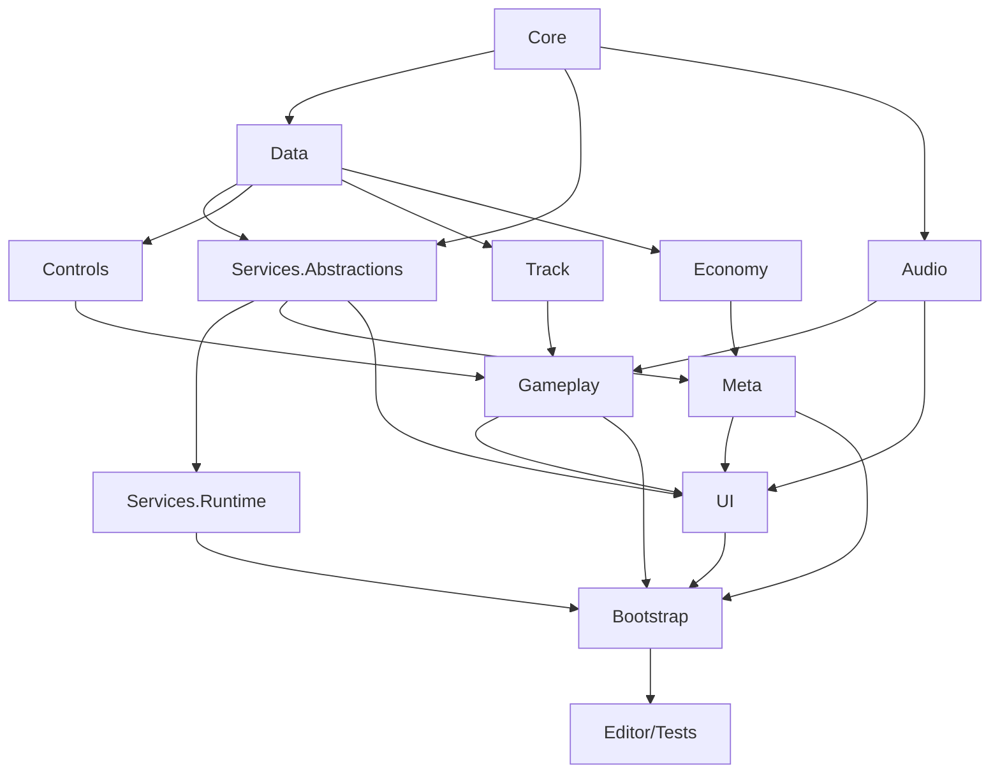
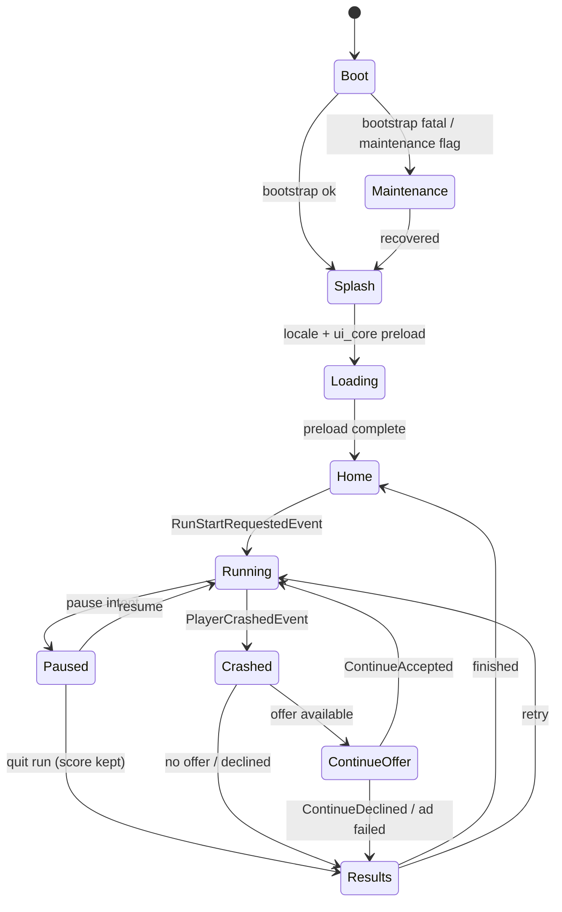
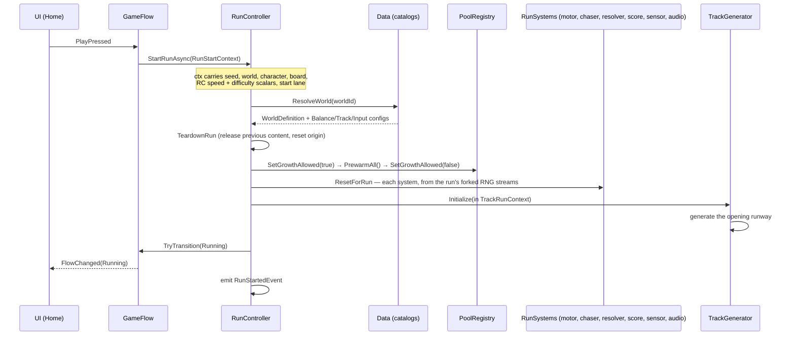
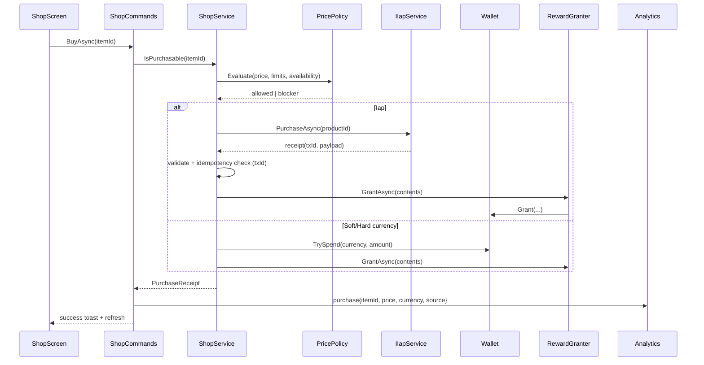
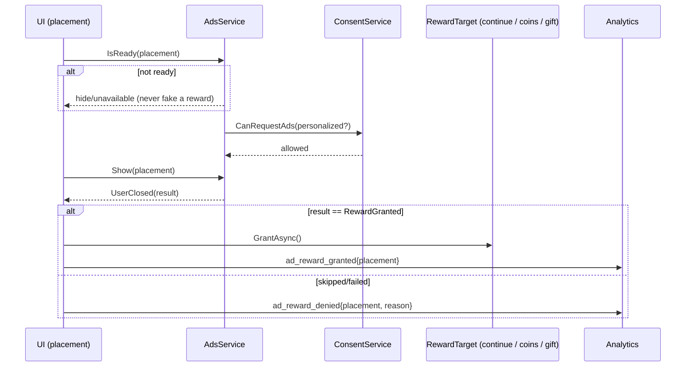
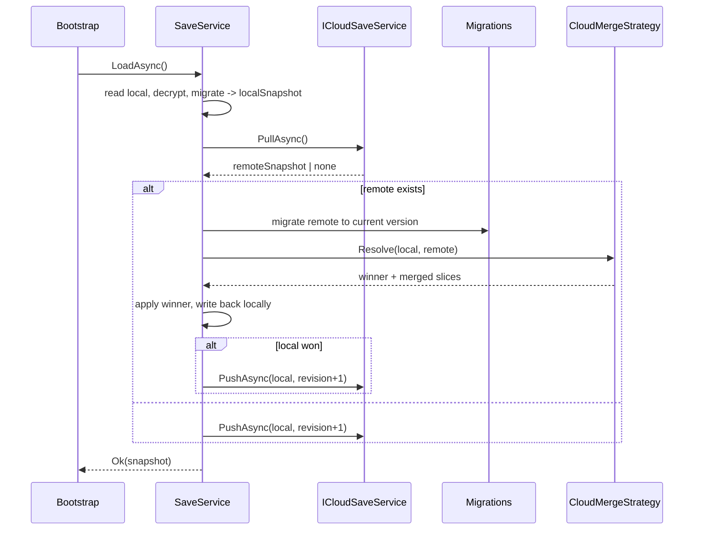

# SKYRIFT — Technical Architecture & Contracts (Evergreen)

**Document class:** living architecture contract. Not a changelog, not a content list.
**Owner:** technical architect. **Audience:** engineers, technical artists, and AI assistants.
**Rule of thumb:** if a sentence would become false when we add a character, a price, a world, or a balance number, it does **not** belong in this file.

---

## 0. How to use this doc with an AI assistant

> Paste the block below at the start of any new session (any AI, any engineer).

```text
CONTEXT — SKYRIFT (Unity 2022.3 LTS, Android endless runner, 3-lane, 3D, URP).

Before you write or change any code:
1. Read /TECH_DOC.md end-to-end. It is the architecture contract. Treat every
   interface signature, event name, dependency arrow, data schema field and
   naming rule in it as binding.
2. Read /CHANGELOG.md §"Current state" to learn what already exists, and
   /ROADMAP.md to learn what is in flight. Do NOT re-derive history from code.
3. Read the relevant ADRs in /Docs/Decisions/ before arguing about a design.

When you implement:
- Follow §7 playbooks for any new content (character, power-up, obstacle/chunk,
  world, mission type, shop item, language, remote-config key, seasonal event).
  Playbooks exist so that adding content NEVER requires editing core systems.
- Respect §3 dependency rules and §4 published interfaces/events. Never add an
  assembly reference that §3 forbids. Never let Gameplay see UI or Services
  concretes. Never let UI reference Services.Runtime concrete types.
- Obey §5 schemas: same field names, types and validation rules. New fields are
  additive and optional, or bump the save schema (§8) with a migration step.
- Obey §11 budgets: zero GC allocations per frame in the gameplay loop, no
  Instantiate/Destroy during a run, no LINQ/foreach/string concat/closure in
  hot paths.
- Do NOT edit TECH_DOC.md unless an architectural CONTRACT changes. Content,
  balance, prices, worlds, features-in-progress go to CHANGELOG.md / ROADMAP.md /
  ADRs. If a contract does change, append a row to §16 Doc revision log in the
  same commit as the change.
- Do not invent numbers in this doc; numbers live in ScriptableObjects/JSON
  under Assets/_Project/Data or in Remote Config (§9).

If a requirement is ambiguous or would force a contract change, STOP and ask.
Prefer adding a class that implements an existing extension point (§15) over
editing a system. When you finish a milestone, report: what was built, how to
test it, known issues, and the exact CHANGELOG.md rows to add.
```

---

## 1. Purpose & scope

### 1.1 Product statement

SKYRIFT is a portrait-orientation, three-lane, forward-auto-run 3D endless runner for Android. The player is a courier riding a maglev hoverboard across a vertical city; a Warden and a hound-drone pursue them. Runs are procedurally assembled from hand-authored track chunks. Meta progression (characters, boards, missions, worlds, shop, events) persists across sessions and clouds.

### 1.2 What this document is for

| It answers | It does not answer |
|---|---|
| How modules are split and what may reference what | Which characters exist, what they cost |
| Which interfaces/events are the public seams between systems | How fast the player runs at minute 3 |
| The exact field list and validation rules of every data type | The actual values in those fields |
| Deterministic flows (run start, crash, purchase, ad, sync) | Marketing copy, store assets |
| Budgets, test strategy, release gates, coding rules | Sprint plans, dates, owners |

### 1.3 Non-goals

- Not a live-ops calendar, not a balance spreadsheet, not a tutorial script.
- Does not describe individual assets; all asset inventories live in `Docs/Art/` and `Docs/Audio/`.

### 1.4 Change control (summary)

| Question | File to edit |
|---|---|
| "What changed in vX?" | `CHANGELOG.md` |
| "What are we building next / in flight?" | `ROADMAP.md` |
| "Why is it built this way?" | `Docs/Decisions/ADR-NNNN-*.md` (append-only, supersede rather than delete) |
| "How do I add X?" | `TECH_DOC.md` §7 (playbook) — then implement |
| "The interface/DAG/schema itself must change" | Code + `TECH_DOC.md` + new ADR + §16 revision row, one commit |

---

## 2. Tech stack & versions policy

### 2.1 Baseline stack (locked contracts)

| Layer | Choice | Notes |
|---|---|---|
| Engine | Unity **2022.3 LTS** | Upgrade path in §2.2; do not silently bump |
| Render pipeline | URP | Single pipeline asset per quality tier; SRP Batcher on; no built-in pipeline shaders |
| Scripting | C#, `.NET Standard 2.1` API level | No reflection in runtime hot paths |
| Backend | IL2CPP, **ARM64 only**, ARMv7 dropped | Required for Play Store 64-bit + size control |
| Min / target SDK | Android **API 26** min, target latest required by Play | Set in ProjectSettings, verified in CI |
| Orientation | Portrait only, `renderOutsideSafeArea = true` | Safe-area handling is mandatory (§4.19) |
| Input | new Input System (`InputActionAsset`) | ScrollWheel/`Legacy Input` disabled |
| Content loading | Addressables | Every screen, character, world, locale pack is an Addressable group |
| UI text | TextMeshPro | Per-locale TMP font asset, no runtime `Font.CreateDynamicFontFromOSFont` |
| Serialization | Newtonsoft (`com.unity.nuget.newtonsoft-json`) for save/config JSON | `JsonUtility` only for tiny editor-time blobs |
| DI | In-house `IServiceContainer` (§4.1), no third-party DI | Constructor injection where possible, locator at scene boundary |
| Async | `UniTask` (Cysharp) or `Task` + custom awaiter | Never `.Result`/`.Wait()` on the main thread |
| Third-party | Firebase (Analytics, Crashlytics, Remote Config, Auth, Firestore), Google Play Games Services, AdMob + UMP, Unity IAP | All wrapped behind `Skyrift.Services.Abstractions` interfaces |
| Tests | Unity Test Framework (EditMode + PlayMode) | EditMode is required to pass on every commit |

### 2.2 Versions policy

1. **Pinning.** `Packages/manifest.json` and `Packages/packages-lock.json` are committed. Third-party plugins are vendored under `Assets/ThirdParty/<vendor>` with their original `package.json`/`.asmdef` and recorded in ADR.
2. **Patch/minor upgrades** (e.g. Firebase 11.x → 11.y) follow the cadence in `ROADMAP.md`, must pass the §12 release checklist on a device, and are logged in `CHANGELOG.md` only.
3. **Engine major upgrades** (2022.3 → 6000.x) require: an ADR, a branch named `engine/<version>`, a full regression pass of §12, and a §16 doc-revision row if any contract (assembly layout, serialization, Addressables API) shifts.
4. **No dependency may be added that forces a contract change** (e.g. a DI framework that replaces `IServiceContainer`) without an ADR.
5. **Upgrade blocker rule:** if a plugin blocks an engine upgrade, the plugin is wrapped or replaced behind its interface — never the reverse.
6. **Deprecation rule:** an interface in §4/§15 is never renamed or removed in place. Add the new member, mark the old `[Obsolete]` with the ADR id, delete after two minor releases.

### 2.3 Build configuration contracts

| Item | Contract |
|---|---|
| Scripting define symbols per environment | `DEV`, `QA`, `PROD` plus feature defines (`SKYRIFT_FIREBASE`, `SKYRIFT_PLAYGAMES`, `SKYRIFT_ADS`, `SKYRIFT_IAP`). Absence of a define must compile and run with mock services. |
| Managed stripping | IL2CPP only — never Mono. The level is **a build-tuning decision, not an architectural one**, so the value in force is in the editor setup tool and `CHANGELOG.md`, not here. The rule: anything reached only by reflection (serialised models, vendor SDK entry points, JSON DTOs) must be preserved explicitly by a `link.xml` in the same change that introduces the reflection, and the level may only be raised once every such consumer is listed. Gameplay code stays reflection-free so this never applies to it. |
| Symbols | `libil2cpp.so` symbols uploaded to Crashlytics each release build |
| Base install | AAB base module ≤ **150 MB**; everything else via Addressables + **Play Asset Delivery** (install-time for core worlds, fast-follow for events) |
| Keystore | Upload key in CI secret store; the project never stores a `.keystore` in git |

---

## 3. Project structure & assembly map

### 3.1 Folder layout

```text
<repo root>/
├── TECH_DOC.md  CHANGELOG.md  ROADMAP.md  README.md  .gitignore  .gitattributes
├── Docs/  { Decisions/ (ADRs), Art/, Audio/, Playbooks/, QA/ }
├── Packages/ (manifest.json, packages-lock.json)
├── ProjectSettings/
└── Assets/
    ├── ThirdParty/          vendored SDKs & plugins, unmodified
    └── _Project/
        ├── Art/             Models/ Materials/ Textures/ VFX/ UI/ Fonts/
        ├── Audio/           Music/Stems/ SFX/ Mixers/
        ├── Prefabs/         Player/ Chunks/ Obstacles/ Collectibles/ UI/ VFX/ Props/
        ├── Scenes/          Boot.unity  Main.unity
        ├── Settings/        URP/ Quality/ Input/ AddressablesGroups/ AudioMixer
        ├── Data/            ← all content, addressed by stable string ids
        │   ├── Characters/ Outfits/ Boards/ Trails/ Worlds/
        │   ├── Chunks/ Obstacles/ Collectibles/ PowerUps/ RewardTables/
        │   ├── Shop/ Missions/ Events/ DailyRewards/ Achievements/ Leaderboards/
        │   ├── Scoring/ Balance/ Input/ Audio/
        │   └── Catalogs/    CatalogManifest assets, RemoteConfigDefaults, FeatureFlags
        ├── Localization/    StringTables/<locale>.json, FontAssets/<locale>
        └── Scripts/         (one folder per assembly, see 3.2)
```

### 3.2 Assembly definitions

| Assembly (.asmdef) | Root namespace | Allowed references | Responsibility |
|---|---|---|---|
| `Skyrift.Core` | `Skyrift.Core` | none (uses only Unity core) | Event bus, service container, state machine, pooling, `IClock`, `IRandomProvider`, math utils, `Result`/`Optional`, logging, ids |
| `Skyrift.Data` | `Skyrift.Data` | Core | ScriptableObject definitions, JSON DTOs/schemas, validators, id constants, catalog interfaces (`IRepository<T>`), `GameDatabase` |
| `Skyrift.Services.Abstractions` | `Skyrift.Services.Abstractions` | Core, Data | All service interfaces (`IAnalyticsService`, `IAdsService`, `IIapService`, `ICloudSaveService`, `IRemoteConfigService`, `IAuthService`, `IPlayGamesService`, `IHapticsService`, `IConsentService`, `INotificationService`, `ILocalizationService`) + their pure DTOs |
| `Skyrift.Services` | `Skyrift.Services` | Core, Data, Abstractions + vendor plugins | Vendor adapters, mock adapters, `SaveService` (local encrypted), encryption, cloud merge, consent/UMP, ad mediation, IAP, Firebase, Play Games |
| `Skyrift.Audio` | `Skyrift.Audio` | Core, Data | `IAudioService`, mixer routing, adaptive music layers, SFX bank, pooled audio sources |
| `Skyrift.Controls` | `Skyrift.Controls` | Core, Data | Input abstraction, swipe/tap detection, command buffer, haptics trigger surface |
| `Skyrift.Track` | `Skyrift.Track` | Core, Data | Chunk repository, weighted difficulty-aware generator, track recycling / floating origin, spawn anchors |
| `Skyrift.Economy` | `Skyrift.Economy` | Core, Data | Wallets, ledgers, spend/grant transactions, rewards, IAP catalog mapping, shop pricing rules |
| `Skyrift.Meta` | `Skyrift.Meta` | Core, Data, Economy, Abstractions | Characters, outfits, boards, progression, missions, daily rewards/streaks, events/worlds, achievements binding, save orchestration |
| `Skyrift.Gameplay` | `Skyrift.Gameplay` | Core, Data, Track, Controls, Audio | Run controller, player motor, lane logic, collisions/stumble, chaser, collectibles, power-ups, scoring, crash/continue run-side |
| `Skyrift.UI` | `Skyrift.UI` | Core, Data, Meta, Economy, Gameplay, Abstractions, Audio | Screen navigation, view models, HUD, settings, shop/missions/character/event screens, tutorial, localization binding |
| `Skyrift.Bootstrap` | `Skyrift.Bootstrap` | everything | Composition root: builds the container, wires services, owns `GameFlowStateMachine`, scene boot, feature-flag gate |
| `Skyrift.Editor` | `Skyrift.Editor` | everything, Editor-only | Validators, catalog importer, data linting, Addressables rules, build scripts |
| `Skyrift.Tests.EditMode` | `Skyrift.Tests` | Core, Data, Track, Economy, Meta | Deterministic unit tests |
| `Skyrift.Tests.PlayMode` | `Skyrift.Tests` | + Gameplay, Bootstrap, UI | Run-loop, pooling, power-up lifetime |

Golden rule: **a new content type adds a `.cs` in the owning assembly and an asset in `Data/`; it never adds a reference between assemblies.**

### 3.3 Dependency rules (enforced)



All other arrows are **forbidden**. Specifically:

| Forbidden | Why | Allowed alternative |
|---|---|---|
| `Gameplay` → `UI` | run must be UI-agnostic and testable headless | events on `IEventBus`; UI subscribes |
| `Gameplay` → `Services.*` | no SDK inside the run loop | emit domain events; `Services` has an `AnalyticsEventBridge` subscriber |
| `UI` → `Services.Runtime` | UI must run against mocks | depend on `Abstractions` only |
| `Data` → anything above it | data must be loadable in EditMode tests | put behaviour in behaviour-SOs in higher assemblies |
| `X` → `X` sibling gameplay systems (e.g. `Economy` → `Gameplay`) | keeps gameplay testable | go through Core events or a Core-level contract |

Unit tests may reference anything upward but nothing may reference tests. Editor-only code may reference runtime code, never the reverse.

### 3.4 Placement rules (where does my file go?)

1. Pure algorithm with no Unity object dependency (generator math, scoring math, wallet) → owning assembly `Runtime/` folder, `internal`-visible-to-tests.
2. Anything with `MonoBehaviour` that runs during a run → `Gameplay` or `Track`.
3. Anything that talks to an SDK → `Services/Runtime` adapter, plus a mock in `Services/Runtime/Mocks`.
4. Anything that describes content → `Data` (SO) + asset in `Data/<Kind>/` + row in a `CatalogManifest`.
5. Anything user-visible → key in `Localization/StringTables/en.json` first, then other locales.
6. Anything that only exists in-editor (validators, importers, menus) → `Skyrift.Editor`.

### 3.5 Scenes

| Scene | Purpose | Contents |
|---|---|---|
| `Boot.unity` | always loaded first, never unloaded | `BootstrapInstaller` prefab instance, `EventSystem`, `AudioListener`, loading canvas, Addressables preload |
| `Main.unity` | gameplay + all UI | `GameRoot` (systems), `PlayerRig`, `TrackRoot`, `ChaserRig`, `UIRoot` canvas (+ screen host), `CameraRig`, `VfxRoot` |

Additive scenes are **not** used for gameplay; screens are Addressable prefabs instantiated under `UIRoot/ScreenHost`.

---

## 4. System-by-system overview

Every subsystem below follows the same documentation shape: **Responsibility → Public contract → Publishes → Consumes → Data → Extension point**. If a system is not listed here, it does not exist as a system; do not invent parallel ones.

### 4.0 Cross-cutting primitives (Core)

| Primitive | Contract |
|---|---|
| `IEventBus` | `Subscribe<T>(Action<T> handler) where T : struct, IGameEvent`, `Unsubscribe<T>(Action<T>)`, `Publish<T>(in T evt)`. One bus for domain events, one for UI events. Subscribe at enable/`OnInit`, always unsubscribe at disable/`OnDispose`. Never publish from a `FixedUpdate` while iterating subscribers — the bus snapshots the handler list per dispatch using a pre-allocated buffer. |
| `IServiceContainer` | `Register<T>(T impl)`, `RegisterLazy<T>(Func<T>)`, `Resolve<T>()`, `TryResolve<T>(out T)`. Resolution at composition time only; gameplay code receives dependencies via `Construct(...)`/`[Inject]` at spawn, never `Resolve` per frame. |
| `IGameStateMachine<TState>` | `TState Current`, `bool TryTransition(TState next)`, `event Action<TState, TState> Transitioned`. Transitions are declared in a table (see §6.1); illegal transitions log an error and are refused. |
| `IObjectPool<T>` | `string Key`, `bool GrowthAllowed`, `PoolStats Stats`, `T Get()`, `void Release(T)`, `void ReleaseAll()`, `void Prewarm(int)`. Non-generic `IPoolable { void OnSpawned(); void OnDespawned(); }`. Zero allocation on `Get`/`Release`. Pools are reached through `IPoolRegistry` by **string** key (§4.6, ADR-0014). |
| `IClock` | `float DeltaTime`, `float UnscaledDeltaTime`, `double NowUtcTicks`. All gameplay timing uses `IClock` so tests can drive time deterministically. |
| `IRandomProvider` | `uint NextUInt()`, `int Range(int minInc, int maxExc)`, `float Value01()`, `IRandomProvider Fork(string streamName)`. Seeded; the run seed is logged and is reproducible for daily challenges and bug reports. |
| `Result` / `Result<T>` | `Ok(...)`, `Fail(code, message)`; used by every fallible service call. No exceptions for expected failures. |
| `StableId` | `readonly struct StableId` wrapping a validated string id (`^[a-z0-9_]{3,48}$`). All cross-asset references use `StableId`, never direct asset references, so content can be addressed before it is loaded. |
| `Logging` | `ILog` with channels (`Log.Channel.Gameplay`, `.Economy`, ...). `Debug.Log` is banned outside `Skyrift.Core.Logging` and editor tools. |

### 4.1 Bootstrap & composition root

**Responsibility:** build the object graph once, in a defined order, and own the top-level game flow. Nothing else may call `Register`.

**Contract**

```csharp
public interface IGameBootstrap {
    Task<Result> InitializeAsync(BootstrapConfig config, CancellationToken ct);
    void Shutdown();
    IServiceContainer Services { get; }
}
```

**Initialization order (fixed, fail-fast at each step)**

1. `Core` primitives: clock → random → event buses → logging.
2. `SaveService` (load, decrypt, migrate — §8). Failure → fresh save + `SaveCorrupted` telemetry, never a crash.
3. Catalogs (`GameDatabase`) from Addressables labels, validated (§5.14). Invalid catalog in `DEV` = throw; in `PROD` = drop the invalid entry + report.
4. `IRemoteConfigService` fetch (with timeout + cached fallback), then `IFeatureFlags` materialized.
5. `ConsentService` (UMP/GDPR + child-safe flag) — must resolve before any ad SDK call.
6. Service adapters gated by feature flags: analytics → crashlytics → auth → cloud save → Play Games → IAP → ads.
7. `Meta` systems (profile, wallet, missions, events, daily) hydrate from save.
8. `Audio`, `Localization` (base locale synchronous, others lazy).
9. Addressables preload (`ui_core`, `characters_base`, base world).
10. UI root + first screen. → `GameFlow` transitions `Boot → Splash`.

**Publishes:** `BootstrapCompletedEvent`, `BootstrapFailedEvent(reason)`.
**Consumes:** nothing.
**Extension point:** `IBootstrapStep` — add a step (order via `[order]` metadata) instead of editing the sequence.

### 4.2 Game flow state machine

**Responsibility:** the single authority on "where is the player". UI screens subscribe; they never decide flow.

**Contract**

```csharp
public enum GameFlowState { Boot, Splash, Loading, Home, Running, Paused, Crashed, ContinueOffer, Results, Maintenance }
public interface IGameFlow {
    GameFlowState Current { get; }
    bool TryTransition(GameFlowState next, in TransitionContext ctx = default);
    event Action<GameFlowState, GameFlowState> Transitioned;
}
```

Meta screens (shop, missions, character select, settings, event, leaderboards) are **not** flow states — they are UI navigation inside `Home`. Only run-related states are in the FSM (diagram in §6.1).

**Publishes:** `GameFlowChangedEvent(from, to)`.
**Consumes:** `RunStartRequestedEvent`, `RunEndedEvent`, `ContinueRequestedEvent`.
**Extension point:** `IGameFlowStateHandler` (`OnEnter/OnExit/CanEnter`), registered per state; new states require an enum + handler + transition-table row (this is the one place the enum is expected to grow).

### 4.3 Input

**Responsibility:** turn raw device input into a small, buffered set of **intents**. It knows nothing about lanes, jumping or the player.

**Contract**

```csharp
public enum InputIntent { SwipeLeft, SwipeRight, SwipeUp, SwipeDown, Tap, Hold, Pause }
public interface IInputSource {
    event Action<InputIntent> IntentIssued;
    void SetEnabled(bool enabled);     // disabled during ads, transitions, pause
    InputDebugState Debug { get; }
}
public interface IInputCommandBuffer {
    void Push(InputIntent intent);     // drops if a newer intent supersedes
    bool TryConsume(out InputIntent intent);
    void Clear();
}
```

**Rules**

- Swipe detection is data-driven (`InputConfig` SO: minimum distance in screen %, maximum duration, tap max duration, dead-zone for horizontal dominance). Diagonal swipes resolve to the dominant axis; ties go to the previously buffered intent.
- Buffer window and max depth come from `InputConfig`; a buffered intent survives across the jump/roll lock only within the window.
- Input is `SetEnabled(false)` on pause, ad open, screen transition and crash; buffer is cleared, never replayed after an ad.
- Keyboard/gamepad intents exist for Editor + PlayMode tests (`KeyboardInputSource`), enabled by `DEV` define.

**Publishes:** `InputIntentIssuedEvent(intent)`. **Consumes:** nothing.
**Extension point:** `IInputSource` (add touch gestures / accelerometer / rewind), `IInputGestureDetector` (swap the detector without touching consumers).

### 4.4 Player locomotion & lanes

**Responsibility:** own player transform, lane index, vertical state (ground/jump/roll), speed curve, and animation parameter flags. It does **not** decide collisions or scoring.

**Contract**

```csharp
public enum PlayerVerticalState { Grounded, Jumping, Falling, Rolling }
public interface IPlayerMotor {
    int Lane { get; }                       // 0..laneCount-1, already retargeted mid-interpolation
    float DistanceRun { get; }              // metres, monotonically increasing through run
    float CurrentSpeed { get; }
    PlayerVerticalState VerticalState { get; }
    bool IsInvulnerable { get; }
    bool IsRecovering { get; }              // stumble slow-down still running
    float HeightAboveGround { get; }        // feet above the WORLD ground plane (clearance reads this)
    float CurrentHeight { get; }            // collision volume height, shorter while rolling
    float GroundHeight { get; }             // top of the surface the rig is supported by, 0 = ground
    float LateralPosition { get; }          // interpolated world X, mid-lane-change included
    float ForwardOffset { get; }            // rig Z inside the current origin-shift window; wraps
    void RequestLaneChange(int delta);      // clamped to the lane count
    void RequestJump(float heightMultiplier = 1f);
    void RequestRoll();
    void RequestLaunch(float upwardVelocity);        // ramp / rooftop launch, may act mid-air
    void SetSpeedProfile(SpeedProfileHandle profile);
    void ResetForRun(RunStartContext ctx);
    void Tick(float dt);                    // the controller owns the simulation order
    void NotifyStumble();
    void SetInvulnerable(float seconds);
    void SetSupportHeight(float metres);    // sensor declares, motor interprets (ADR-0015)
    void AddJumpModifier(IJumpModifier m);   void RemoveJumpModifier(IJumpModifier m);
    void AddSpeedModifier(ISpeedModifier m); void RemoveSpeedModifier(ISpeedModifier m);
    void SetLaneChangeRule(ILaneChangeRule rule);
}
```

`Tick`, `NotifyStumble`, `SetInvulnerable` and `SetSupportHeight` are part of the contract because the motor
never reads a clock, never runs its own `Update`, never decides why it was stumbled and never learns what an
obstacle **is** (ADR-0015).

**Rules**

- Lane change is a smooth interpolation toward the target lane's X (curve + duration from `BalanceConfig`); a second swipe mid-interpolation retargets without snapping. Lateral "queue depth" is capped at 1 pending lane change.
- Jump/roll cancel each other; roll has a minimum duration and a maximum duration; jump height/time is modulated by the active speed profile and any jump-modifier contributions (e.g. super-sneakers) — modifiers are **contributions**, not booleans (`IJumpModifier`).
- Speed: `SpeedProfile` is a piecewise curve over `DistanceRun` with a cap and a difficulty scalar from Remote Config (§9). Speed never decreases within a run except on stumble recovery.
- Vertical motion is integrated against `GroundHeight`, **not** against zero (ADR-0015). `SetSupportHeight` is called by the contact sensor — the only system that reads physics — with the top of the mountable surface the rig is over, or 0. The motor decides what that means: land on it, step up onto it, or fall off its far edge. Losing the surface is a fall from rest rather than a snap to the ground plane, so walking off a roof reads as a drop. `HeightAboveGround` stays measured from the world ground plane so clearance maths remains absolute and a contact check cannot be fooled by a roof.
- Landing, step-up and fall-off are resolved from the **simulated step**, never from a rendered frame, so rooftop support behaves identically at 30 and 120 fps.
- Animation is driven by `PlayerAnimationDriver` reading motor state; no animation events drive gameplay.
- The player never moves in world Z directly — the rig carries `ForwardOffset` inside the current origin-shift window and `DistanceRun` is an accumulated scalar; see floating origin in §4.6.

**Publishes:** `PlayerLaneChangedEvent`, `PlayerJumpedEvent`, `PlayerLandedEvent`, `PlayerRollStartedEvent`, `PlayerRollEndedEvent`, `PlayerSpeedChangedEvent`.
**Consumes:** `InputIntent` via `IRunController` (motor never subscribes to input itself).
**Extension point:** `IJumpModifier`, `ISpeedModifier`, `ILaneChangeRule` (e.g. a power-up that allows 1→3 lane dashes).

### 4.5 Track generation

**Responsibility:** produce an endless, fair, procedurally-varied track from hand-authored **chunks**, and keep exactly the configured number of chunks alive ahead of and behind the player.

**Contract**

```csharp
public interface ITrackGenerator {
    void Initialize(in TrackRunContext ctx);       // run-scoped dependency bundle, see below
    ChunkHandle PeekNext(int lookahead = 1);       // query only, never mutates the track
    void EnsureCoverage(float playerDistance);     // called each frame, allocation-free
    void Recycle(float playerDistance);            // returns chunks fully behind the player
    void SetPlayerSpeed(float metresPerSecond);    // feeds the difficulty model
    void SetDifficultyScale(float scale);          // run-scoped RC scalar; Initialize resets it to 1
    void Shutdown();                               // release every live chunk
    TrackDebugState Debug { get; }
    int LiveCount { get; }
    ChunkHandle GetLive(int index);                // ordered, oldest first
    void AddEligibilityRule(IChunkEligibilityRule rule);
    void AddSelectionWeight(IChunkSelectionWeight weight);
}

// Everything a run needs to generate track, passed once. Carrying the pool registry, the origin shifter,
// the bus and the populator here — instead of as Initialize arguments — is what keeps a new generator
// dependency from changing the signature every subsystem already agreed on.
public readonly struct TrackRunContext {
    public readonly TrackGenerationConfig Config;
    public readonly WorldDefinition World;
    public readonly IGameDatabase Database;
    public readonly IRandomProvider Random;        // forked "track" stream (ADR-0005)
    public readonly IPoolRegistry Pools;
    public readonly IEventBus Bus;
    public readonly ILog Log;
    public readonly IWorldOriginShifter Origin;
    public readonly Transform TrackRoot;
    public readonly IChunkPopulator Populator;
}

public interface IChunkEligibilityRule {          // extension point, data-registered
    bool IsEligible(in ChunkCandidateContext ctx);
}
public interface IChunkSelectionWeight {          // extension point, data-registered
    float Weight(in ChunkCandidateContext ctx);   // 0 = never pick
}
```

An incomplete `TrackRunContext` is refused at `Initialize` (logged, generator stays inert) rather than
throwing: a null dependency is an authoring or wiring error that must be visible at boot, not a
`NullReferenceException` three chunks later.

**Selection algorithm (contract, not a config value)**

1. Compute `targetDifficulty` from `DistanceRun`, run speed and the world's difficulty curve.
2. From `ChunkRepository` take all chunks whose: world tag matches, difficulty band contains `targetDifficulty`, entry-lane mask matches the previous chunk's exit-lane mask (all lanes at the start of a run), per-chunk cooldown has elapsed, and **all** `IChunkEligibilityRule`s pass. The rule list is the whole filter — the generator has no built-in branch of its own, so a new hard constraint is a rule, not an edit.
3. Weight each candidate by every `IChunkSelectionWeight` contribution multiplied together (authored base weight, repeat penalty, difficulty fit), short-circuiting as soon as the product reaches zero — a zero is a veto, not a discount.
4. Weighted-pick with the seeded RNG; if nothing is eligible, fall back to the guaranteed "safe" chunk set for the current world and report telemetry `track_generation_fallback`. If even the fallback is empty, the track cannot continue: logged, counted, and the generator stops rather than inventing geometry.
5. Guarantee every generated sequence leaves at least one traversable lane. This is proven by an EditMode corpus walk of the same conjunction of rules (§12.1), run against every authored chunk set — a set that dead-ends at a difficulty the ramp will certainly reach must not ship.

**Rules**

- Chunks are prefab-backed content addressed by the catalog; the generator deals in `ChunkHandle` (pool slot + anchors) and never `Instantiate`. Delivery through Addressables is §4.20 / ADR-0012; the generator's own **content** dependency is `IGameDatabase` alone — everything else it touches (pools, bus, origin, populator) arrives through `TrackRunContext`, so a new generator dependency is a context field, not a new module edge.
- The generator holds **no** gameplay logic. Spawn anchors are declared by the chunk prefab (`ChunkDefinition` + `ChunkRoot`); populating a chunk from its definition is the `IChunkPopulator` the run controller injects (pooled spawns of obstacles/collectibles). The **interface** is declared in Track so the generator can name it without knowing gameplay; the shipped **implementation** lives in Gameplay, because populating needs obstacle behaviours — that direction is the DAG, not a preference (§3.3).
- Live chunks are re-based on an origin shift through `IOriginShiftListener` rather than being parented to a shifted root (§4.6, ADR-0014).
- Determinism: same seed + same catalogs + same RC values ⇒ same sequence. Required for daily challenges and repro of bug reports. Subsystems draw from **forked** streams so adding a consumer cannot change an existing run's layout (ADR-0005).

**Publishes:** `ChunkActivatedEvent`, `ChunkRecycledEvent`, `TrackFallbackEvent`.
**Consumes:** `RunStartedEvent`, `PlayerSpeedChangedEvent`, `WorldChangedEvent`.
**Extension point:** `IChunkEligibilityRule`, `IChunkSelectionWeight`, `IChunkPopulator` (custom decoration pass, e.g. event collectibles).

### 4.6 Pooling & world recycling (floating origin)

**Responsibility:** zero runtime `Instantiate`/`Destroy` during a run, and keep world coordinates small enough for float precision.

**Contract**

```csharp
public interface IPoolRegistry {
    void Register(PoolEntry entry, Transform parent);        // one row of PoolCatalog per key
    IObjectPool<PooledEntity> GetPool(string key);           // throws and names the key when unregistered
    bool TryGetPool(string key, out IObjectPool<PooledEntity> pool);
    void PrewarmAll();                                       // loading phase only
    void SetGrowthAllowed(bool allowed);                     // flipped off for the whole run
    void ReleaseAll();
    IReadOnlyList<string> Keys { get; }
    int OverflowCount { get; }                               // aggregate, for telemetry
}
public interface IObjectPool<T> where T : PooledEntity {
    string Key { get; }
    bool GrowthAllowed { get; set; }
    PoolStats Stats { get; }          // struct snapshot: Active / Inactive / Created / Overflow
    T Get();
    void Release(T item);
    void ReleaseAll();
    void Prewarm(int count);          // targets the TOTAL instance count, so it is idempotent
}
public interface IPoolable { void OnSpawned(); void OnDespawned(); }

public interface IWorldOriginShifter {
    double OriginOffset { get; }                        // metres shifted so far, always a multiple of the threshold
    void Configure(float thresholdMetres);              // power of two; non-positive falls back to the default
    void ShiftIfNeeded(float playerDistance);           // at most ONE threshold per call — call every frame
    void RegisterRoot(Transform root);   void UnregisterRoot(Transform root);
    void RegisterListener(IOriginShiftListener l); void UnregisterListener(IOriginShiftListener l);
    void ResetForRun();                                 // reverses every root and zeroes the offset
}
public interface IOriginShiftListener { void OnOriginShifted(double deltaMetres); }
```

A pool is keyed by **string**, not by `Component` type (ADR-0014): a chunk, an obstacle and a coin differ by
prefab and by prewarm budget, not by component type, and a `PooledEntity` subclass is what carries the
behaviour a typed `Get<Component>()` would have implied. `PoolKey` as a distinct value type was dropped for
the same reason the catalog is a data asset of strings — a second spelling of the same thing drifts.

**Rules**

- Every pooled prefab is registered in a `PoolCatalog` asset (key, prefab, prewarm count, category). Nothing is created ad-hoc. A row that cannot be pooled is skipped with an error rather than aborting the boot of the other rows.
- Pools grow on demand only during a **loading** phase, never mid-run; a mid-run exhaustion recycles the **eldest active** item (the one furthest behind the player, so the one the run has least use for), runs its release hook first, and reports `pool_overflow` telemetry. An empty pool that is not allowed to grow still creates one instance rather than handing `null` into the gameplay loop.
- `OnSpawned` runs **after** `SetActive(true)` and `OnDespawned` **before** `SetActive(false)`, so a hook can always read and reset the object it is handed; the spawner positions the instance after `Get`, so a hook must never depend on a transform it does not own.
- `activeSelf` is the spawn flag: releasing an already-inactive instance is ignored, which is what stops a double release from putting one object on the free list twice.
- Floating origin: when the player has travelled another threshold since the last shift, every **registered root** moves back by `-threshold` on the travel axis and `OriginOffset += threshold`. Roots are discrete (player rig, chaser rig, VFX root), not one world parent: anything that stores an accumulating local coordinate must re-base itself through `IOriginShiftListener` instead (live chunks do), because translating a parent *and* accumulating inside it is the precision loss the shift exists to prevent (ADR-0014). Released pooled objects are deliberately **not** registered — they hold no live position.
- **Run distance is an accumulated scalar and is never derived from a world coordinate**, so a shift cannot change a score, a distance or a difficulty ramp. `OriginOffset` exists only so absolute-position bookkeeping (trails, decals, particle simulation space, audio occlusion) can subtract the delta; the rig's own Z inside the current window is exposed as `ForwardOffset` and wraps at the threshold.
- Duplicate registrations are refused on both roots and listeners, a destroyed root is stepped over rather than fatal, and `ShiftIfNeeded` performs at most one shift per call so a sudden teleport is unwound over several frames instead of one giant pop.
- Recycled chunks reset all particle systems, audio sources and pooled children (`IPoolable.OnDespawned`).

**Publishes:** `OriginShiftedEvent(double newOffset, double deltaMetres)` — the delta is carried because a listener needs what moved *this* shift, not the running total.
**Consumes:** `ChunkRecycledEvent`.
**Extension point:** `IPoolable`, `IOriginShiftListener`, `PoolCatalog` (data).

### 4.7 Collision & stumble

**Responsibility:** decide the outcome of every contact between player and world, with a two-hit stumble model and rules that live in data.

**Contract**

```csharp
public enum ContactOutcome { Ignored, Grazed, Stumbled, Crashed, Cleared }
public enum ContactSurface { Head, Torso, Feet, Side, Top }
public readonly struct ContactContext {
    public readonly ContactSurface Surface;
    public readonly int PlayerLane, ObjectLane;
    public readonly float PlayerSpeed, RelativeSpeed;      // RelativeSpeed <= 0 = object outruns the player
    public readonly float HeightAboveGround;               // feet above the WORLD ground plane
    public readonly float PlayerHeight, ObjectHeight;      // volume top vs object top
    public readonly float LateralOffset;                   // centre distance in lane widths
    public readonly PlayerVerticalState VerticalState;
    public readonly bool HasShield;
    public readonly ClearanceProfile Clearance;            // authored jump/roll/mount windows
    public readonly IObstacleBehaviour Behaviour;          // the archetype, carried in, not looked up
    public readonly BalanceConfig Balance;                 // forgiveness + graze thresholds travel too
}
public interface ICollisionResolver {
    ContactOutcome Resolve(in ContactContext ctx);   // pure, allocation-free, unit-testable
    int StumbleCount { get; }                        // resets at run start / continue
    void ResetForRun();
    void ResetStumbles();                            // a continue forgives, without a full run reset
}
public interface IObstacleBehaviour {                // per obstacle archetype
    ContactOutcome Resolve(in ContactContext ctx);
}
```

Clearance data, the archetype behaviour and the balance thresholds travel **inside** the context. That is
what makes both the resolver and every behaviour a pure function of its input: nothing in §4.7 resolves a
catalog or a config asset at contact time, which is why the whole model is testable with constructed inputs
(ADR-0006).

**Outcome rules (contract; magnitudes are data)**

| Situation | Outcome |
|---|---|
| Player clears a low obstacle while airborne above its clearance height | `Cleared` |
| Player passes under a high obstacle while rolling | `Cleared` |
| Side scrape with a barrier at ground level (not head-on) | `Stumbled` on the **first** hit in a run, `Crashed` on the second |
| Head-on hit into a full blocker / train at run speed | `Crashed` (instant) |
| Any contact while a crash-absorbing power-up is active | absorb, consume the charge, `Grazed` |
| Contact with a ramp surface | `Cleared` + launch impulse (only when the contact is on `Top` and the surface is mountable) |

Classification order for a mountable/clearable obstacle is jump clearance → roll clearance → mount height →
lateral graze, and the last step is what separates a side scrape from a head-on hit:
`LateralOffset >= grazeLateralThreshold ? Stumbled : Crashed`. Shield substitution to `Grazed` happens in the
**resolver** (which owns the escalation), not in a behaviour.

- `ICollisionResolver` is pure: same context ⇒ same outcome. All "state" is the stumble counter, exposed and resettable.
- Physics is **not** used for obstacle contact: contacts come from trigger volumes + the resolver (deterministic, testable, cheap). Rigidbody is used only for the player's own gravity/ground checks.
- The sensor that reports contacts is also the only system that declares the motor's support surface (§4.4, ADR-0015), because it is the only one that reads physics.
- A stumble briefly slows the player, plays the stumble animation, and notifies the chaser (§4.8); the second stumble in the same run crashes. Only a `Stumbled` outcome increments the counter.

**Publishes:** `PlayerStumbledEvent(count)`, `PlayerCrashedEvent(CrashCause cause, in CrashContext ctx)`, `ContactResolvedEvent(outcome)` (debug/telemetry only).
**Consumes:** nothing (called by `PlayerContactSensor`).
**Extension point:** `IObstacleBehaviour` + `ObstacleBehaviourCatalog` (data registers `StableId → behaviour factory`); `IContactOutcomePolicy` to swap the whole stumble model.

### 4.8 Chaser (Warden + hound-drone)

**Responsibility:** visible pursuit pressure that reacts to stumbles, never actually ends the run by itself.

**Contract**

```csharp
public interface IChaserSystem {
    float Proximity { get; }          // 0 = far behind (safe), 1 = caught up
    void OnPlayerStumbled();
    void OnPlayerRecovered();
    void ResetForRun();
    void Tick(float dt, float playerSpeed);
}
```

**Rules**

- A stumble snaps `Proximity` toward the player; it decays back over time (rates from `BalanceConfig`). Proximity drives animation, audio (breathing, footsteps, mix), camera and post-fx — it is *presentation + pressure*, it does not directly kill.
- Chaser visuals are pooled alongside the player rig and participate in the floating origin shift.
- A second stumble → crash (per §4.7); the chaser's "catch" animation plays during the crash sequence.

**Publishes:** `ChaserProximityChangedEvent(proximity)`, `ChaserCaughtPlayerEvent`.
**Consumes:** `PlayerStumbledEvent`, `PlayerSpeedChangedEvent`.
**Extension point:** `IChaserBehaviour` (alternate pursuers per world, data-selected), `IChaserAnimationDriver`.

### 4.9 Collectibles

**Responsibility:** spawn, animate, magnet-attract, and award coins/keys/mystery pickups and letter events.

**Contract**

```csharp
public interface ICollectibleSpawner {
    void SpawnOnChunk(ChunkHandle chunk);                  // data-driven patterns
    void Collect(CollectibleInstance instance, CollectContext ctx);
}
public interface ICollectiblePattern {                    // extension point
    void Emit(in PatternContext ctx, ICollectibleEmit sink);
}
public interface IAttractorSink { void AttractTo(Vector3 target, float strength); }
```

- Patterns: `line`, `arc`, `over-obstacle`, `zigzag`, `cluster`, all authored as `CollectiblePatternDefinition` data referenced by chunk definitions. Adding a pattern = new `ICollectiblePattern` class + data entry.
- Magnet effect and per-collectible pickup radius are power-up contributions (`IPickupRadiusModifier`), not fields on the coin.
- Collection awards through the economy API (`IRewardGranter`), never by mutating the wallet directly.
- Letter/word events are a `CollectionEventDefinition` (letters with spawn weights); completing the word grants a reward from a `RewardTableDefinition`.

**Publishes:** `CollectibleCollectedEvent(kind, amount)`, `WordCompletedEvent(wordId)`, `MysteryBoxOpenedEvent(tableId, grants)`.
**Consumes:** `PowerUpActivatedEvent` (magnet), `RunStartedEvent`.
**Extension point:** `ICollectiblePattern`, `ICollectibleKindBehaviour`, `ICollectibleAwardPolicy`.

### 4.10 Power-ups

**Responsibility:** one activation/lifetime/stacking engine for every power-up; individual behaviours are pluggable.

**Contract**

```csharp
public enum StackingRule { RefreshDuration, ExtendDuration, ReplaceWithLonger, AddCharges, IgnoreWhileActive, QueueUntilExpired }

public interface IPowerUpService {
    bool TryActivate(StableId powerUpId, ActivationSource source);
    void Deactivate(StableId powerUpId, DeactivationReason reason);
    bool IsActive(StableId powerUpId);
    float RemainingDuration(StableId powerUpId);
    int Charges(StableId powerUpId);
    void Tick(float dt);
    void ResetForRun();
    ActivePowerUpSnapshot Snapshot { get; }   // allocation-free read for HUD
}

[CreateAssetMenu]
public abstract class PowerUpEffectBehaviour : ScriptableObject {   // extension point
    public virtual void OnActivated(PowerUpRuntime rt, IPowerUpContext ctx) { }
    public virtual void OnTick(PowerUpRuntime rt, float dt) { }
    public virtual void OnDeactivated(PowerUpRuntime rt, DeactivationReason reason) { }
}
```

**Rules**

- Stacking/priority/duration/charge rules are **data** (`PowerUpDefinition`: stacking rule, priority, duration, max charges, activation conditions, upgrade levels). Code only interprets the rule enum.
- Effects apply as *contributions* to well-known channels: speed, jump height, pickup radius, score multiplier, crash absorption, invulnerability, camera/FX. A new power-up that touches only these channels needs **zero** code.
- A power-up needing new mechanics implements `PowerUpEffectBehaviour` — a new class, no engine edits.
- Upgrade levels multiply authored parameters via `PowerUpLevelTable` (data), never hardcoded.
- Expiry is driven by `IClock` so tests can fast-forward; `Tick` is called once per frame by `RunController`, not per-power-up `Update`.

**Publishes:** `PowerUpActivatedEvent(id, source, level)`, `PowerUpDeactivatedEvent(id, reason)`, `PowerUpChargeConsumedEvent(id)`.
**Consumes:** `RunStartedEvent`, `ChunkActivatedEvent` (auto-grant pickups), `PlayerCrashedEvent` (consume shield).
**Extension point:** `PowerUpEffectBehaviour`, `IPowerUpUpgradeCurve`, `IActivationCondition`.

### 4.11 Scoring

**Responsibility:** one deterministic score value derived from contributions, with multipliers from power-ups and mission sets.

**Contract**

```csharp
public interface IScoreCalculator {
    long CurrentScore { get; }
    float DistanceMetres { get; }
    int Combo { get; }
    void Tick(float dt, float playerSpeed);          // allocation-free, no LINQ
    void OnCollected(int amount, CollectibleKind kind);
    void OnPowerUpMultiplierChanged(float factor);
    ScoreBreakdown Breakdown { get; }                // struct snapshot for results screen
    void ResetForRun();
}
public interface IScoreContributor { float Contribute(in ScoreContext ctx); }   // extension point
public interface IScoreModifier    { float Modify(float baseScore, in ScoreContext ctx); }
```

- Score = (distance × distanceWeight) + Σ(collection × kindWeight) + combo bonus, all × product of active multipliers. Weights/curves are data (`ScoringConfig`).
- Combo increments on collection within a data-defined window and decays on stumble/crash.
- The results screen reads `ScoreBreakdown` only — it must never recompute.

**Publishes:** `ScoreChangedEvent(score, delta)`, `ComboChangedEvent(combo)`, `ScoreMultiplierChangedEvent(factor)`.
**Consumes:** `CollectibleCollectedEvent`, `PowerUpActivatedEvent`/`DeactivatedEvent`, `MissionSetCompletedEvent`.
**Extension point:** `IScoreContributor`, `IScoreModifier`, `ScoringConfig` (data).

### 4.12 Run orchestration & crash/continue

**Responsibility:** the only place that starts, pauses, ends a run and drives the crash → continue → results sequence.

**Contract**

```csharp
public interface IRunController {
    RunState State { get; }
    Task<Result> StartRunAsync(RunStartContext ctx, CancellationToken ct);
    void Pause(); void Resume();
    void EndRun(EndRunReason reason);
    ContinueOffer BuildContinueOffer();          // key cost from data, escalating per run
    Task<ContinueResult> TryContinueAsync(ContinueSource source, CancellationToken ct);
    RunSummary Summary { get; }
}
```

**Rules**

- `StartRunAsync`: resolve world + character + boards + active modifiers → `TrackGenerator.Initialize(seed)` → prewarm pools → reset all run systems → input enabled → flow `Running`.
- Crash: freeze gameplay simulation (time scale 0 on the run clock, **not** `Time.timeScale`) → play crash sequence on unscaled time → raise `RunCrashedEvent` → flow `Crashed` → optional `ContinueOffer`.
- Continue sources, key cost escalation and ad availability all come from data + Remote Config; the controller only asks `IContinueOfferPolicy`.
- Ending: score committed, wallet granted, missions progressed, analytics emitted, save written, flow `Results`.
- Only one run may be active; `StartRunAsync` returns `Fail(RunAlreadyActive)` otherwise.

**Publishes:** `RunStartedEvent`, `RunPausedEvent`, `RunResumedEvent`, `RunCrashedEvent(cause)`, `ContinueOfferedEvent(cost)`, `RunContinuedEvent(source)`, `RunEndedEvent(summary)`.
**Consumes:** `InputIntent`, `PlayerCrashedEvent`, `GameFlowChangedEvent`.
**Extension point:** `IContinueOfferPolicy`, `IRunModifier` (mutators applied to a run, e.g. event rules), `IRunSummaryPresenter` (data).

### 4.13 Economy

**Responsibility:** the only writer of currency and inventory balances. Everything else requests grants/spends.

**Contract**

```csharp
public interface IWallet {
    long Get(StableId currencyId);
    bool TrySpend(StableId currencyId, long amount, SpendReason reason, out TransactionId tx);
    TransactionId Grant(StableId currencyId, long amount, GrantReason reason);
    IReadOnlyList<CurrencyBalance> Snapshot();
}
public interface IRewardGranter {
    Task<Result> GrantAsync(RewardBundle bundle, GrantReason reason, CancellationToken ct);
}
public interface IShopService {
    bool IsPurchasable(StableId shopItemId, out PurchaseBlocker blocker);
    Task<Result<PurchaseReceipt>> PurchaseAsync(StableId shopItemId, CancellationToken ct);
    IReadOnlyList<ShopOffer> GetActiveOffers(OfferSurface surface);
}
```

- Every mutation goes through a `TransactionId` and emits a ledger event — the ledger is the audit trail for support and for save diffing.
- `RewardBundle` is a data type (currency amounts, item ids, weights) resolved by `IRewardTableResolver`; reward tables are weighted and data-driven.
- Pricing, discounts, daily deals and IAP mapping are data + Remote Config overrides; code has no prices.
- IAP receipts are validated through `IIapService` then granted via `IRewardGranter` (never directly), and are idempotent by transaction id.

**Publishes:** `CurrencyChangedEvent(currencyId, delta, balance, reason)`, `PurchaseCompletedEvent(itemId, price, currencyId)`, `RewardGrantedEvent(bundleId)`.
**Consumes:** `CollectibleCollectedEvent`, `AdRewardGrantedEvent`, `RunEndedEvent`, `MissionCompletedEvent`.
**Extension point:** `IPriceRule`, `IRewardTableResolver`, `IPurchaseProcessor` (new payment/store kind), `ISpendPolicy` (currency gates).

### 4.14 Meta: profile, characters, missions, daily, events

**Responsibility:** everything that persists between runs.

| System | Contract | Publishes | Consumes |
|---|---|---|---|
| Profile | `IProfileService.Current` (read-only snapshot), `SetSelectedCharacter(StableId)`, `SetSelectedBoard(StableId)` | `ProfileChangedEvent` | `CurrencyChangedEvent` (unlock affordability) |
| Ownership | `IOwnershipService.Owns(OwnableRef)`, `Unlock(...)` | `ItemUnlockedEvent`, `CharacterUnlockedEvent` | `RewardGrantedEvent`, `PurchaseCompletedEvent` |
| Characters | `ICharacterService.GetPerks(StableId)` → `PerkContribution[]`, applied by gameplay as modifiers | `CharacterSelectedEvent` | `RunStartedEvent` |
| Outfits / boards / trails | Pure data variants + `ICosmeticService` | `CosmeticEquippedEvent` | `ProfileChangedEvent` |
| Missions | `IMissionService.GetActiveSets()`, `IMissionEvaluator` per type, `ReportProgress(DomainSignal)` | `MissionProgressEvent`, `MissionCompletedEvent`, `MissionSetCompletedEvent` | all gameplay domain events, via `MissionSignalAdapter` |
| Daily rewards | `IDailyRewardService.CanClaimToday`, `ClaimAsync`, streak state | `DailyRewardClaimedEvent(streakDay)` | `IClock` day rollover |
| Events / world tour | `IEventService.ActiveEvents`, `IWorldTourService.CurrentWorld`, world resolution by RC schedule | `WorldChangedEvent(worldId)`, `EventStartedEvent`, `EventEndedEvent` | `IRemoteConfigService`, `IClock` |
| Achievements | `IAchievementService.Progress(achievementId, delta)` → maps to platform ids | `AchievementUnlockedEvent` | `MissionCompletedEvent`, gameplay signals |

**Key rule:** missions, achievements and events all react to **domain signals on the event bus**. A new gameplay feature becomes mission-compatible by publishing a signal (and adding one data row), not by editing the mission system.

**Publishes (shared):** `MissionSetCompletedEvent` (feeds the global score multiplier), `WorldChangedEvent`.
**Extension point:** `IMissionEvaluator` (one class per mission *type*), `IMissionSetModifier`, `IEventParticipationRule`, `IWorldResolver`, `IPerkContribution`.

### 4.15 Save system

**Responsibility:** durable, versioned, encrypted, cloud-syncable player state.

**Contract**

```csharp
public interface ISaveService {
    SaveSnapshot Current { get; }
    Task<Result> LoadAsync(CancellationToken ct);
    Task<Result> SaveAsync(SaveFlushReason reason, CancellationToken ct);
    Task<Result> ResetAsync();                     // data-deletion request path
    void MarkDirty(SaveSlice slice);
    event Action<SaveLoadedEvent> Loaded;
}
public interface IMigrationStep { int FromVersion { get; } int ToVersion { get; } void Migrate(ISaveDocument doc); }
public interface ISaveEncryptionProvider { byte[] Protect(byte[] plain); bool TryUnprotect(byte[] data, out byte[] plain); }
```

- Slices: `Run`, `Ownership`, `Progression`, `Settings`, `Missions`, `Events`, `Stats`, `Economy`. Each slice is a separate JSON node so a broken slice can be dropped without losing the rest.
- Writes are debounced (coalesced) except on high-value events (purchase, unlock, run end) which flush immediately.
- Load order: local decrypted → migrate (§8) → remote (if newer per §4.17) → reconcile → write back.
- Never throw on corruption: quarantine the bad file, load defaults, report `save_recovered`.
- Schema and migrations: §8.

**Extension point:** `SaveSlice` (new slice = new `ISaveSliceCodec` + registration), `IMigrationStep`, `ISaveEncryptionProvider`.

### 4.16 Remote Config & feature flags

**Responsibility:** all live-tunable numbers, ad cadence, event schedule and kill-switches, with safe fallbacks.

**Contract**

```csharp
public interface IRemoteConfigService {
    T Get<T>(RemoteConfigKey<T> key);              // returns local default when unavailable
    bool TryGet<T>(RemoteConfigKey<T> key, out T value);
    Task<Result> RefreshAsync(CancellationToken ct);
    RemoteConfigSource Source { get; }             // Default | Cached | Network
    event Action Refreshed;
}
public interface IFeatureFlags {
    bool IsEnabled(FeatureFlag flag);
    IReadOnlyList<FeatureFlag> All { get; }
}
```

- Every key is declared **once** in a static `RemoteConfigKeys` class with type, default (from `RemoteConfigDefaults` asset) and clamp range (§9). Reads are typed and clamped; an out-of-range remote value is clamped + reported, never trusted.
- Feature flags gate every major feature (ads, IAP, cloud save, events, leaderboards, tutorial). With all flags off the game must boot and be playable offline.

**Extension point:** `RemoteConfigKeys` (additive), `IFeatureFlag` + `IGate` (a gate can override a flag per-AB/per-world).

### 4.17 Services layer (adapters behind interfaces)

| Interface | Responsibility | Mock | Notes |
|---|---|---|---|
| `IAnalyticsService` | typed event + user property sink; batched | logs to console/`AnalyticsChannel` | never blocks; queue capped, drops oldest |
| `ICrashReportingService` | exceptions, custom keys, non-fatals | no-op | enabled after consent |
| `IAuthService` | anonymous → linked account | fake user | Play Games sign-in is optional, never blocking |
| `ICloudSaveService` | push/pull `SaveSnapshot` + `revision` | local file | conflict rule §4.17.1 |
| `IAdsService` | rewarded / interstitial / banner, cached readiness, frequency caps | always-ready rewarded, never interstitial | UMP consent gate before first init |
| `IIapService` | product catalog, purchase, restore, receipt | simulated purchases | idempotent grant by tx id |
| `IPlayGamesService` | leaderboards, achievements, sign-in | local stubs | feature-flagged off by default in `DEV` |
| `IHapticsService` | short haptic cues by intensity class | no-op | respects accessibility toggle |
| `IConsentService` | UMP/GDPR, child-safe profile, ads personalization | auto-grant in `DEV` | must resolve before ads/analytics identity |
| `INotificationService` | local notifications (daily reward) | no-op | opt-in only |
| `ILocalizationService` | locale resolution, string table, TMP font swap | en only | lazily loads non-base locales |

#### 4.17.1 Cloud conflict resolution (contract)

1. Both sides carry `schemaVersion`, `revision` (monotonic per device write), `updatedAtUtcTicks` and a `deviceId` hash.
2. Migrate both to the current schema version **before** comparing.
3. Winner = `remote.revision > local.revision && remote.updatedAtUtcTicks > local.syncBaselineTicks` → **remote wins**. Otherwise **local wins** and is pushed.
4. Non-conflicting additive slices (`Stats`, `Progression`) are max-merged after the winner is chosen; authoritative slices (`Economy`, `Ownership`) are never merged.
5. Every resolution emits `cloud_sync_result{winner, reason}`.

**Extension point:** `IServiceAdapter` per interface, `IAdFrequencyPolicy`, `IConsentFlow`, `ICloudMergeStrategy`.

### 4.18 Audio

**Responsibility:** mixer groups, pooled SFX, adaptive layered music.

**Contract**

```csharp
public interface IAudioService {
    void PlaySfx(SfxId id, SfxParams p = default);
    void PlayMusic(MusicId id, bool crossfade = true);
    void SetMusicIntensity(float normalized01);     // 0 calm → 1 full chase
    void SetBusVolume(AudioBus bus, float volume01);
    void PauseAll(bool paused);
}
```

- Music is a set of stems (base / percussion / lead / chase) on one `AudioMixer` group; intensity cross-fades stem weights driven by speed + chaser proximity (`MusicIntensityDriver`).
- Sfx are pooled `AudioSource`s with voice caps per cue; the mixer's `Master`/`Music`/`SFX`/`UI` groups are exposed to settings.
- Pauses respect `Paused` (music ducks) and ads (all muted).

**Publishes:** nothing. **Consumes:** `PlayerSpeedChangedEvent`, `ChaserProximityChangedEvent`, `GameFlowChangedEvent`, volume settings.
**Extension point:** `SfxDefinition` (data), `IMusicIntensityDriver`.

### 4.19 UI, navigation, localization, accessibility

**Responsibility:** all screens, HUD and their view models; never contains gameplay rules.

**Contract**

```csharp
public interface IUINavigator {
    Task<Result> PushAsync(ScreenId id, ScreenArgs args = null);
    Task PopAsync();
    Task ReplaceAsync(ScreenId id, ScreenArgs args = null);
    Task ClearToAsync(ScreenId id);
    IReadOnlyList<ScreenId> Stack { get; }
}
public interface IUIScreen { Task OnShowAsync(ScreenArgs args); Task OnHideAsync(); }
public interface IHudView { void Bind(IHudViewModel vm); }
public interface ILocalizationService {
    string Get(LocalizationKey key, params object[] args);
    event Action LocaleChanged;
    string CurrentLocale { get; }
}
```

- Screens are Addressable prefabs keyed by `ScreenId`; every screen root has `SafeAreaFitter` (notch/cutout) and anchors designed for 16:9 → 21:9.
- View models are structs/classes built from read-only system snapshots; UI never calls `TrySpend` directly — it calls a command (`IShopCommands.BuyAsync`) which handles confirmation, errors and analytics.
- Localization: keys are strings in `LocalizationKey` (generated constants); missing keys fall back to `en` and report `loc_missing_key` once per key per session.
- Accessibility: colorblind-safe palette variants, icon+shape redundancy for all state indicators, haptics toggle, reduced-motion option, dynamic-text-safe layouts.
- Tutorial is a **data-driven step list** (`TutorialDefinition`: prompt key, required intent, gate condition, completion event); `TutorialService` injects fake input highlights without breaking `IInputSource`.

**Publishes:** `ScreenShownEvent(id)`, `ScreenHiddenEvent(id)`, `TutorialStepCompletedEvent(stepId)`.
**Consumes:** `GameFlowChangedEvent`, `CurrencyChangedEvent`, `MissionProgressEvent`, `RunEndedEvent`, `PowerUpActivatedEvent`, `ScoreChangedEvent`.
**Extension point:** `IUIScreen` (new screen = prefab + one class + `ScreenId` data row), `IViewBinder`, `ICommand` (per screen action), `ITutorialStepCondition`.

### 4.20 Data catalogs (`GameDatabase`)

**Responsibility:** one addressable, validated index of every `StableId` → asset.

**Contract**

```csharp
public interface IRepository<TDefinition> where TDefinition : ScriptableObject, IIdentifiable {
    bool TryGet(StableId id, out TDefinition def);
    IReadOnlyList<TDefinition> All { get; }
}
public interface IGameDatabase {
    IRepository<CharacterDefinition> Characters { get; }
    IRepository<ChunkDefinition> Chunks { get; }
    // ... one repository per §5 type; plus a generic Resolve for tooling
    Result Validate(ValidationReport report);   // called on boot in DEV, in editor before build
}
```

- Catalogs are built from `CatalogManifest` assets in Addressables groups, so a world/event can ship as its own downloadable pack.
- Validation rules are §5.14 and are run by the editor build script — **a build fails on a catalog validation error in `PROD`**.

---

## 5. Data schemas

Two storage forms exist and both are versioned:

- **ScriptableObjects** — authoring-time, human-editable, live in `Assets/_Project/Data/`.
- **JSON** — save files, remote overrides, string tables, and (optionally) bulk content for live-ops without a build.

Universal conventions:

| Convention | Rule |
|---|---|
| Identity | every definition has `string id` (`StableId`, `^[a-z0-9_]{3,48}$`, globally unique **per type**, immutable once shipped) |
| Display text | no display strings in data. Every visible string is a `LocalizationKey` (e.g. `char.warden_stalker.name`) |
| References | cross-asset references are `StableId` strings, never object references, so content can be lazy-loaded and validated |
| Assets | addresses (Addressables) are `StableId` strings under a fixed prefix: `<type>/<id>` |
| Numbers | all tunables are serialized with `[Range]`, `[Min]`, or `[Tooltip]`; no magic numbers in code |
| Versioning | definitions carry no version; the **catalog** carries `contentVersion`, consumed by RC for live-ops gating |
| Obligatory interfaces | `IIdentifiable { StableId Id { get; } }`, `IValidatable { ValidationResult Validate(); }` |

### 5.1 `CharacterDefinition`

| Field | Type | Req | Rules |
|---|---|---|---|
| `id` | StableId | ✔ | unique |
| `displayNameKey` | LocalizationKey | ✔ | exists in `en` |
| `descriptionKey` | LocalizationKey | ✔ | exists in `en` |
| `portraitAddress` / `prefabAddress` | Addressables key | ✔ | resolves; prefab has `PlayerAvatar` root |
| `unlockKind` | enum `Free, SoftCurrency, HardCurrency, Keys, Event, Achievement` | ✔ | if `Free`, price fields must be 0 |
| `unlockPrice` | `CurrencyAmount[]` | ✔ | non-negative; ≤ 2 entries |
| `perkId` | StableId (optional) | | resolves via `perkContribution` catalog; gameplay applies it as a modifier contribution |
| `defaultOutfitId` | StableId | ✔ | belongs to this character |
| `stats` | `CharacterStats` (cosmetic only: `voicePitch`, `trailOffset`) | | never affects gameplay balance |
| `sortOrder` | int | ✔ | ≥ 0, unique per list |

### 5.2 `OutfitDefinition` / `BoardDefinition` / `TrailDefinition`

| Field | Type | Req | Rules |
|---|---|---|---|
| `id` | StableId | ✔ | unique per type |
| `ownerCharacterId` | StableId | outfit only | resolves to a character |
| `displayNameKey`, `descriptionKey` | LocalizationKey | ✔ | |
| `prefabAddress` / `materialVariantAddress` | Addressables key | ✔ | |
| `unlockKind`, `unlockPrice` | as §5.1 | ✔ | |
| `isDefault` | bool | | exactly one default per owner |

### 5.3 `WorldDefinition`

| Field | Type | Req | Rules |
|---|---|---|---|
| `id` | StableId | ✔ | unique; becomes Addressables label `world.<id>` |
| `displayNameKey` | LocalizationKey | ✔ | |
| `environmentPrefabAddress` | Addressables key | ✔ | |
| `chunkTagFilter` | `StableId[]` | ✔ | every entry used by ≥1 chunk |
| `difficultyCurve` | `AnimationCurve` | ✔ | monotonically non-decreasing |
| `musicId` | StableId | ✔ | resolves in audio catalog |
| `palette` | `WorldPalette` (colors, fog, light) | ✔ | |
| `availableFromUtc` / `availableToUtc` | string (ISO-8601, optional) | | both or neither |
| `rcScheduleKey` | string (optional) | | when set, RC overrides the date window |
| `assetPackLabel` | string | ✔ | an Addressables/Play Asset Delivery label |

### 5.4 `ChunkDefinition`

| Field | Type | Req | Rules |
|---|---|---|---|
| `id` | StableId | ✔ | unique |
| `prefabAddress` | Addressables key | ✔ | prefab has `ChunkRoot` + ≥1 `SpawnAnchor` |
| `worldTags` | `StableId[]` | ✔ | ∩ world's `chunkTagFilter` ≠ ∅ |
| `lengthMetres` | float | ✔ | > 0; must equal the prefab's collider length (±0.5 m) |
| `difficultyBand` | `Vector2` (min,max in 0..1) | ✔ | min ≤ max |
| `entryLaneMask` / `exitLaneMask` | int bitmask | ✔ | non-zero; lane count ≤ world lane count |
| `baseWeight` | float | ✔ | > 0 |
| `cooldownChunks` | int | ✔ | ≥ 0 (chunks generated before it may repeat) |
| `safeFallback` | bool | | at least 1 per world must be `true` |
| `obstacleSlots` | `ObstacleSlotData[]` | | each slot: lane, `zWithinChunk`, allowed `obstacleTagSet`, required bool |
| `collectiblePatterns` | `CollectiblePatternRef[]` | | pattern id + slot/lane range |
| `biomeProps` | `PropPlacement[]` | | purely visual |
| `playtestNotes` | string | | free text, not shipped to the client |

### 5.5 `ObstacleDefinition`

| Field | Type | Req | Rules |
|---|---|---|---|
| `id` | StableId | ✔ | unique |
| `prefabAddress` | Addressables key | ✔ | |
| `behaviourId` | StableId | ✔ | resolves in `ObstacleBehaviourCatalog` (data → factory) |
| `tagSet` | `StableId[]` | ✔ | matched by chunk slots |
| `clearance` | `ClearanceProfile` (jumpable, rollable, mountable, laneOccupancyMask) | ✔ | lane mask non-zero |
| `footprintMetres` | `Vector2` (length, height) | ✔ | > 0 |
| `isMoving` | bool | | if true `motionProfile` required |
| `motionProfile` | `ObstacleMotion` (axis, amplitude, period, phase) | cond | amplitudes within chunk bounds |
| `crashFxKey` / `impactSfxId` | StableId | ✔ | resolve |
| `spawnWeightMultiplier` | float | ✔ | > 0 |

### 5.6 `CollectibleDefinition`

| Field | Type | Req | Rules |
|---|---|---|---|
| `id` | StableId | ✔ | unique |
| `kind` | enum `Coin, Key, Gem, Letter, PowerUpPickup, MysteryBox` | ✔ | drives award routing |
| `prefabAddress` | Addressables key | ✔ | |
| `baseValue` | int | ✔ | ≥ 0 |
| `currencyId` | StableId | cond | required when `kind` grants currency |
| `powerUpId` | StableId | cond | required when `kind == PowerUpPickup` |
| `rewardTableId` | StableId | cond | required when `kind == MysteryBox` |
| `pickupRadius` | float | ✔ | > 0 |
| `attractable` | bool | ✔ | |
| `poolKey` | StableId | ✔ | exists in `PoolCatalog` |
| `sfxId`, `vfxKey` | StableId | ✔ | resolve |

### 5.7 `CollectiblePatternDefinition`

| Field | Type | Req | Rules |
|---|---|---|---|
| `id` | StableId | ✔ | |
| `patternId` | StableId | ✔ | resolves to an `ICollectiblePattern` implementation |
| `collectibleIds` | `StableId[]` | ✔ | ≥1, each resolves |
| `paramsJson` | string | | parsed by the pattern; must be valid JSON |
| `laneMode` | enum `SingleLane, AllLanes, RandomLane` | ✔ | |
| `minSpacingMetres` | float | ✔ | ≥ collectible radius ×2 |

### 5.8 `PowerUpDefinition`

| Field | Type | Req | Rules |
|---|---|---|---|
| `id` | StableId | ✔ | |
| `displayNameKey`, `iconAddress` | LocalizationKey / address | ✔ | |
| `stackingRule` | enum §4.10 | ✔ | |
| `priority` | int | ✔ | higher wins ties; unique per conflicting channel |
| `baseDurationSeconds` | float | ✔ | > 0 |
| `maxCharges` | int | ✔ | ≥ 1 |
| `levelTable` | `PowerUpLevelEntry[]` (level → duration multiplier, charge bonus, upgrade cost) | ✔ | levels contiguous from 1, costs non-decreasing |
| `effectBehaviourAddress` | Addressables key | ✔ | asset derives `PowerUpEffectBehaviour` |
| `activationConditionId` | StableId (optional) | | resolves to `IActivationCondition` |
| `channels` | `PowerUpChannelContribution[]` (channel, magnitude, curve) | | channels: `Speed, JumpHeight, PickupRadius, ScoreMultiplier, CrashAbsorb, Invulnerability, FxIntensity` |
| `pickupCollectibleId` | StableId | | the collectible that grants it |
| `sfxId`, `vfxKey`, `hudIconAddress` | StableId | ✔ | |

### 5.9 `RewardTableDefinition`

| Field | Type | Req | Rules |
|---|---|---|---|
| `id` | StableId | ✔ | |
| `entries` | `RewardEntry[]` (`weight`, `rewardBundle`, `minPlayerLevel`, `maxPerSession`) | ✔ | Σweight > 0; rewards non-empty |
| `rolls` | `Vector2Int` (min,max) | ✔ | 1 ≤ min ≤ max |
| `guaranteedEntryIds` | `StableId[]` | | must exist in `entries` |
| `pityRules` | `PityRule[]` (table, threshold, forced entry) | | thresholds > 0 |

### 5.10 `ShopItemDefinition`

| Field | Type | Req | Rules |
|---|---|---|---|
| `id` | StableId | ✔ | |
| `surface` | enum `Main, Characters, Boards, PowerUps, Offers, Event` | ✔ | |
| `displayNameKey`, `descriptionKey`, `iconAddress` | ✔ | |
| `purchaseKind` | enum `SoftCurrency, HardCurrency, Iap, RewardedAd, EventOnly` | ✔ | |
| `priceCurrencyId`, `priceAmount` | StableId / long | cond | required unless `Iap` |
| `iapProductId` | string | cond | required if `Iap`; must exist in store catalog |
| `contents` | `RewardBundle` | ✔ | non-empty |
| `limits` | `PurchaseLimit` (perDay, perAccount, lifetime) | | 0 = unlimited |
| `availability` | `AvailabilityWindow` (`fromUtc`,`toUtc`,`requirementId`) | | |
| `sortOrder`, `badgeKey` | int / LocalizationKey | | |

### 5.11 `MissionDefinition` / `MissionSetDefinition`

| Field | Type | Req | Rules |
|---|---|---|---|
| `id` | StableId | ✔ | |
| `missionTypeId` | StableId | ✔ | resolves to an `IMissionEvaluator` |
| `objectiveKey` | LocalizationKey | ✔ | |
| `paramsJson` | string | | schema owned by the evaluator |
| `targetValue` | long | ✔ | > 0 |
| `reward` | `RewardBundle` | ✔ | non-empty |
| `signalId` | StableId | ✔ | the domain event name the evaluator listens to |
| *Set*: `id`, `missionIds[3]`, `requiredCount`, `setReward`, `multiplierBonus`, `canReroll`, `rerollCost` | | ✔ | exactly 3 missions in shipped data (set size is a schema constant, count is data) |

### 5.12 `EventDefinition` (seasonal / world tour)

| Field | Type | Req | Rules |
|---|---|---|---|
| `id` | StableId | ✔ | |
| `worldId` | StableId | ✔ | resolves |
| `startUtc`, `endUtc` | string | ✔ | start < end |
| `rcScheduleKey` | string (optional) | | RC overrides dates without a build |
| `contentPackLabel` | string | ✔ | downloadable Addressables label |
| `rewardTrackId` | StableId | ✔ | resolves to a reward table |
| `participationRuleId` | StableId | ✔ | resolves to `IEventParticipationRule` |
| `themedShopItemIds`, `leaderboardId` | arrays / StableId | | must resolve |

### 5.13 Configuration assets

| Asset | Key fields (contract) |
|---|---|
| `BalanceConfig` | speed curve (distance→m/s), speed cap, lane count, lane width, lane-change duration/curve, jump height/airtime, roll duration, stumble slow factor/recovery, chaser proximity rise/fall, difficulty scalar bounds |
| `ScoringConfig` | distance weight, per-kind weights, combo window/step/cap, multiplier composition order |
| `TrackGenerationConfig` | chunks ahead/behind, difficulty ramp, repeat penalty, fallback chunk set, origin shift threshold |
| `InputConfig` | swipe min distance %, max swipe duration, tap max duration, buffer window, buffer depth |
| `AdsConfig` (defaults only) | interstitial cooldown, runs-between-ads, session cap, rewarded placements enabled |
| `EconomyConfig` | currency ids, continue key cost schedule, daily deal slots, reroll cost base |
| `InputConfig`, `AudioConfig` (bus volumes, voice caps), `UILocalizationConfig` (locale list, fallback) | |

### 5.14 Validation rules (enforced before build, on boot in `DEV`)

1. Every `id` matches `StableId` and is unique per type.
2. Every `LocalizationKey` resolves in `en`; non-`en` gaps are warnings.
3. Every Addressables key resolves **inside its declared group**.
4. Every `StableId` cross-reference resolves (hard error in `PROD`).
5. Numeric ranges: no negative durations/prices/weights; no zero-length curves; `min ≤ max` everywhere.
6. Each `WorldDefinition` has ≥1 `safeFallback` chunk and ≥1 chunk per difficulty band edge.
7. Each `MissionDefinition.missionTypeId` resolves to an evaluator instance discovered at load.
8. Each `ShopItemDefinition` of kind `Iap` has a product id present in the store catalog (validated at runtime, warns at build).
9. Reward tables: Σweight > 0, no duplicate entry ids, guaranteed entries ⊆ entries.
10. Pool catalog: every prefab has a unique `poolKey` and a prewarm ≥ 0.
11. Save: every registered slice codec has a unique name and a migration path to the current schema version (§8).
12. A failed validation in `PROD` drops the offending entry and reports `catalog_invalid`; a failed validation in Editor blocks the build.

### 5.15 `SaveFile` (JSON, see §8 for versioning)

```json
{
  "schemaVersion": 0,
  "revision": 0,
  "updatedAtUtcTicks": 0,
  "deviceIdHash": "",
  "slices": {
    "economy": {}, "ownership": {}, "progression": {}, "settings": {},
    "stats": {}, "missions": {}, "events": {}, "run": {}
  },
  "checksum": ""
}
```

Slice payloads are owned by their systems, but these field names are contract:

| Slice | Contract fields |
|---|---|
| `economy` | `balances: {currencyId: long}[]`, `ledgerCursor: long` |
| `ownership` | `ownedItemIds: string[]`, `selectedCharacterId`, `selectedBoardId`, `selectedOutfitId`, `selectedTrailId` |
| `progression` | `playerLevel`, `xp`, `highestScore`, `missions: { setId: { progress[], completed } }`, `powerUpLevels: { id: level }`, `characterLevels` |
| `settings` | `musicVolume`, `sfxVolume`, `qualityTier`, `locale`, `haptics`, `notifications`, `reducedMotion`, `colorblindMode`, `analyticsConsent`, `adsPersonalizationConsent` |
| `stats` | `runsStarted`, `runsCompleted`, `totalDistance`, `totalCoins`, `totalKeys`, `crashesByCause: {}[]`, `continuesUsed`, `playSeconds` |
| `missions` | `activeSetId`, `progress: {}[]`, `lastRerollUtcTicks`, `completedSetCount` |
| `events` | `activeEventId`, `eventProgress`, `claimId`, `dailyStreak`, `lastClaimUtcTicks` |
| `run` | `inProgress: bool`, `seed`, `distanceAtCrash`, `continueCount` (used to restore an interrupted run once) |

---

## 6. Diagrams & deterministic flows

### 6.1 Game flow state machine



Transition table (the only legal edges; anything else is refused + logged):

| From | Allowed to | Guard |
|---|---|---|
| `Boot` | `Splash`, `Maintenance` | bootstrap result |
| `Splash` | `Loading` | addressables + locale ready |
| `Loading` | `Home` | preload complete or timed out with fallback |
| `Home` | `Running` | no active run; run context valid |
| `Running` | `Paused`, `Crashed`, `Results` | — |
| `Paused` | `Running`, `Results`, `Home` | — |
| `Crashed` | `ContinueOffer`, `Results` | `IContinueOfferPolicy.CanOffer()` |
| `ContinueOffer` | `Running`, `Results` | continue grant succeeded |
| `Results` | `Home`, `Running` | — |
| `Maintenance` | `Splash` | maintenance flag off |

### 6.2 Run start



The pool prewarm happens **before** any system is reset or a chunk is spawned, and growth is switched off
again immediately afterwards: from the first tick onward, a pool miss is a defect to be reported rather than
an `Instantiate` to be hidden (§4.6, ADR-0007).

Every failure path returns a typed `Result` and lands the controller back in `Idle` with the previous run's
content released — a refused start never leaves a half-built simulation running. The controller does not own
screens, so recovering the *flow* (back to `Home`) is the caller's decision, taken from the returned error
code. Telemetry attaches the step that failed.

### 6.3 Crash → continue → results

```mermaid
sequenceDiagram
    participant P as Player
    participant C as CollisionResolver
    participant R as RunController
    participant F as GameFlow
    participant U as ContinueScreen
    participant E as Economy
    participant A as Ads

    P->>C: Resolve(in ContactContext)
    C-->>R: publishes PlayerCrashedEvent(cause, context)
    Note over C,R: the bus is the only crash transport — the resolver holds no<br/>reference to the controller, so a crash can originate in a sensor,<br/>a behaviour, a debug key or a test without changing either party
    R->>R: freeze run clock, play crash sequence
    R-->>F: Crashed
    R->>R: BuildContinueOffer (policy + RC gates)
    alt offer available
        F->>U: ContinueOffer (key cost, ad option, countdown)
        Note over R: the countdown runs on unscaled time; expiry ends the run with<br/>reason ContinueDeclined while the recorded cause stays the crash
        U->>E: TrySpend(keys, cost)
        alt keys ok
            E-->>R: TryContinueAsync(Keys) → Ok
            R->>F: Running (invulnerability + cleared respawn window)
        else ad chosen
            U->>A: ShowRewarded(continue)
            A-->>R: TryContinueAsync(RewardedAd) → Ok
            R->>F: Running
        else declined
            R->>R: EndRun(ContinueDeclined) → commit score, wallet, missions, save
            R-->>F: Results
        end
    else
        R->>R: EndRun(Crash) → commit
        R-->>F: Results
    end
```

A grant is only honoured if the controller is still in `ContinueOffer` when the payment or ad callback lands;
if the countdown expired first the offer is refused and the run stays ended. A player cannot buy their way
back into a run the game has already closed (§4.12).

### 6.4 Purchase (IAP and soft currency)



Rules: idempotent by `txId`; failed validation → no grant + `iap_validation_failed`; consumption replays on next boot if a grant was interrupted (`pendingGrants` in the ownership slice).

### 6.5 Rewarded ad reward



Rewards are granted **only** in the SDK's reward callback; the close callback alone never grants. Grant + analytics are idempotent per session+placement+run id.

### 6.6 Cloud sync



Offline / not signed in: push is queued and retried on next successful auth; `revision` only increments on a local winning write, so queued pushes never overwrite newer remote data.

---

## 7. How-to playbooks

Each playbook is a checklist. If a step requires editing a file outside the listed set, the playbook is wrong — fix the playbook in the same PR (that is a contract change).

### 7.1 Add a character

1. `Data/Characters/<id>.asset` — new `CharacterDefinition`; fill every required field (§5.1).
2. Character prefab under `Prefabs/Player/Characters/<id>.prefab` with `PlayerAvatar` root; add to the `characters` Addressables group.
3. Default outfit asset + `OutfitDefinition` (`ownerCharacterId` = new id, `isDefault = true`).
4. Portrait texture → `Art/UI/Characters/<id>.png` → address `ui/characters/<id>`.
5. Localization keys `char.<id>.name` / `.desc` in **all** shipped locales (non-`en` may be machine-drafted + flagged in `Docs/QA/loc-gaps.md`).
6. Optional perk: data-only via `PerkContribution` + `CharacterDefinition.perkId`.
7. Add a `ShopItemDefinition` only if it must appear in the shop surface.
8. Run `Tools > Skyrift > Validate Catalogs`; zero errors.
9. Test: unlock in a dev save (`Tools > Skyrift > Debug Save`), select, start a run, verify perk contribution in the debug HUD.
10. Add a `CHANGELOG.md` row. **No code changes.**

### 7.2 Add a power-up

1. `PowerUpDefinition` asset (§5.8) — set `stackingRule`, `priority`, base duration, charges, level table.
2. If existing channels suffice (`Speed/JumpHeight/PickupRadius/ScoreMultiplier/CrashAbsorb/Invulnerability/FxIntensity`): **stop, it is done** — fill `channels`.
3. If new mechanics: create `MyPowerUpEffect : PowerUpEffectBehaviour` in `Skyrift.Gameplay/PowerUps/Effects`, implement `OnActivated/OnTick/OnDeactivated`, create the SO asset, reference it from `effectBehaviourAddress`.
4. Grant source: `CollectibleDefinition` (`kind = PowerUpPickup`, `powerUpId`) and/or `ShopItemDefinition`.
5. HUD: add an icon asset + `hud/<id>` address; the HUD reads `IPowerUpService.Snapshot` (no code needed if the icon address is set).
6. Localization keys `powerup.<id>.name` / `.desc`.
7. Tests: EditMode for stacking rule table; PlayMode for activation/expiry/charge consumption.
8. `CHANGELOG.md` row.

### 7.3 Add an obstacle

1. Prefab under `Prefabs/Obstacles/<id>.prefab` with trigger collider(s) sized to the footprint.
2. `ObstacleDefinition` asset (§5.5); set `behaviourId`:
   - Reuse `jumpable`, `rollable`, `full_blocker`, `moving`, `ramp`, `grazeable` from the behaviour catalog — **preferred**, no code.
   - Otherwise: new `IObstacleBehaviour` class in `Skyrift.Gameplay/Obstacles/Behaviours`, register it in `ObstacleBehaviourCatalog` (data list) with a new `behaviourId`.
3. Add to `PoolCatalog` (key, prewarm).
4. Reference it from chunk `obstacleSlots` (`obstacleTagSet` must match the definition's `tagSet`).
5. Verify clearance math in the debug overlay (`Tools > Skyrift > Obstacle Clearance Debug`).
6. EditMode test: `CollisionResolverTests` case per new behaviour × vertical state.

### 7.4 Add a chunk

1. Model/prefab under `Prefabs/Chunks/<world>/<id>.prefab`; root has `ChunkRoot`, a sizing collider, and `SpawnAnchor` children.
2. `ChunkDefinition` asset (§5.4): world tags, length (must match prefab), difficulty band, entry/exit lane masks, weight, cooldown, `safeFallback` if it is trivially traversable.
3. Place obstacle slots and collectible pattern refs; assign pool keys implicitly via definitions.
4. Addressables: add to `world.<worldId>` group.
5. Run `Tools > Skyrift > Track > Simulate 10k Chunks` for the world; confirm no `track_generation_fallback` and no unreachable-lane reports.
6. Playtest in `Tools > Skyrift > Playtest Chunk` (isolated runner).

### 7.5 Add a world / theme

1. `WorldDefinition` asset (§5.3) with palette, environment prefab, music id, difficulty curve, `assetPackLabel`.
2. Environment prefab + props under `Prefabs/Props/<world>/`; add to a dedicated Addressables group so it can ship as an asset pack.
3. Author (or retag) ≥ 1 `safeFallback` chunk and a chunk set per difficulty band.
4. Music: add a `MusicId` to the audio catalog with its stems.
5. Optional scheduling: set `rcScheduleKey` and add that key to §9 (string, ISO dates).
6. In the editor, `Tools > Skyrift > Worlds > Validate World <id>`.
7. Test: force the world in a dev save / RC override, run once, verify music, palette, chunk tags, asset pack load/unload and memory release.

### 7.6 Add a mission type

1. New `IMissionEvaluator` in `Skyrift.Meta/Missions/Evaluators/<Name>Evaluator.cs`:
   `StableId TypeId`, `void OnSignal(in DomainSignal signal, MissionRuntime rt)`, `void OnTick(...)` if needed.
2. Register it in `MissionEvaluatorCatalog` (data asset list of type→evaluator bridge ids).
3. Author `MissionDefinition`s using `missionTypeId = <new>` and a `paramsJson` schema documented in the evaluator's XML comment.
4. The evaluator must publish progress only through `IMissionService.ReportProgress` (no direct writes).
5. EditMode test: feed synthetic signals, assert progress/clamping/completion.
6. **No changes** to mission set assembly, rotation, rewards or UI.

### 7.7 Add a shop item

1. `ShopItemDefinition` (§5.10) with surface, purchase kind, contents, limits, availability.
2. Localization keys `shop.<id>.name` / `.desc` / optional `.badge`.
3. If `Iap`: add the product to the store catalog **before** shipping and mirror the id in `IapCatalogDefaults`; runtime validates and hides unlisted products.
4. If it appears in daily deals: add its id to the relevant `DailyDealSetDefinition`.
5. Test in `DEV` with the simulated IAP adapter and a wallet-fill cheat.

### 7.8 Add a language

1. `Localization/StringTables/<locale>.json` copy of `en.json` with identical keys.
2. Add the locale to `UILocalizationConfig.supportedLocales` and set `fallbackLocale = en`.
3. Add TMP font asset(s) under `Localization/FontAssets/<locale>/` (Latin/Cyrillic/CJK subsets as needed) and register the font mapping.
4. Addressables: add the locale to the `localization` group with the `loc.<locale>` label.
5. RTL locales additionally require `RTLTextAdapter` on screen roots — validate with the RTL preview toggle.
6. Test: switch locale at runtime, verify no missing keys (`loc_missing_key` count = 0 in console), verify font coverage with the pseudo-locale.

### 7.9 Add a Remote Config key

1. Add a typed key to `RemoteConfigKeys` with name, type, default and clamp (§9 row).
2. Add the default value to the `RemoteConfigDefaults` asset (source of truth for offline).
3. Add the row to §9 of this doc (name, type, meaning, safe range) — this is a registry, not a content list.
4. Consume via `IRemoteConfigService.Get(key)`; never read raw values.
5. Publish it in the Firebase console **before** shipping the client that reads it.
6. If the key gates a feature, expose it as a `FeatureFlag` instead (§4.16).

### 7.10 Ship a seasonal event

1. `EventDefinition` (§5.12) with world, dates, RC schedule key, content pack label, reward track, participation rule.
2. Ensure the world ([§7.5](#75-add-a-world--theme)) and its asset pack are downloadable (fast-follow, not base).
3. Reward track = `RewardTableDefinition` chain; themed shop items = `ShopItemDefinition`s tagged `Event`.
4. Leaderboard: create the Play Games leaderboard, add the id to `LeaderboardDefinition`, and set the RC leaderboard key.
5. Remote Config: set `event.active_id` + `event.schedule_json`; the client must handle "event in future", "event live", "event ended (grace window)", and "event removed".
6. Analytics funnel: `event_started`, `event_progress`, `event_reward_claimed`, `event_ended`.
7. Rollback path: clear `event.active_id` via RC — the client falls back to the default world without a build.

### 7.11 Add a UI screen

1. Prefab under `Prefabs/UI/Screens/<Name>Screen.prefab` with `SafeAreaFitter` + `UIScreenRoot`.
2. `ScreenId` data row (id, prefab address, allowed flow states, analytics screen name).
3. One `MonoBehaviour : IUIScreen` in `Skyrift.UI`; bind a view model from read-only snapshots.
4. Actions go through `ICommand` implementations that own validation + analytics.
5. Localization keys for every visible string; add to `LocalizationKey`.
6. Test: navigation push/pop from each entry point, back-button behaviour, safe-area on notch simulator, and 21:9 aspect.

---

## 8. Save-data versioning & migrations

### 8.1 Contract

| Element | Contract |
|---|---|
| `schemaVersion` | int, monotonically increasing, **never** reused or skipped. Current version is a constant `SaveSchema.CurrentVersion` in `Skyrift.Data`. |
| Migration unit | one `IMigrationStep` per version hop (`N → N+1`), pure function over `ISaveDocument` (JSON nodes), independently unit-tested. |
| Chain | `SaveMigrator` applies steps in order until `CurrentVersion`. A missing hop in the chain is a **build-breaking** error (validated on boot in `DEV`, in the editor build script in `PROD`). |
| Forward-compat | If `schemaVersion > CurrentVersion` (user downgraded the app), do **not** migrate; load read-only "safe mode" (defaults + cloud snapshot), never overwrite the file. |
| Additive changes | New optional fields with defaults need **no** version bump; they must be `null`-safe on read. |
| Removals/renames/semantic changes | Require a version bump + a migration step + a test with a golden fixture of the old schema. |
| Fixtures | `Assets/_Project/Scripts/Tests/EditMode/Fixtures/save_v<N>.json` for every shipped version, kept forever. |
| Encryption | Per-slice AES-256-GCM; key derived from a device-stable identifier + app secret, versioned by `encVersion` so a key rotation can migrate. Unreadable data ⇒ quarantine + defaults (never a crash). |
| Checksum | SHA-256 over the canonical JSON (sorted keys) to detect truncation. |
| Atomicity | Write `save.tmp` → fsync → rename over `save.json`; keep `save.bak` for one generation. |
| Reset | `ISaveService.ResetAsync()` wipes local + queues a cloud delete; must be reachable from Settings (data-deletion request, §12). |

### 8.2 Adding a migration (procedure)

1. Bump `SaveSchema.CurrentVersion`.
2. Add `Migration_N_to_N1 : IMigrationStep` in `Skyrift.Services/Save/Migrations/`, transforming only the affected slices.
3. Register it in `SaveMigrator` (ordered list).
4. Add fixture `save_v<N>.json` and an EditMode test asserting the migrated document and that a save/load round-trip is stable.
5. Add a `CHANGELOG.md` row (`save: schema N → N+1`).
6. Do **not** touch `TECH_DOC.md` — the mechanism is unchanged.

### 8.3 Rules for IDs in saves

Player-visible ids may never be renamed. If content is retired: keep the definition marked `retired = true` (never delete the asset), stop offering it, and keep its id resolvable so old saves migrate cleanly. A save referencing an unknown id must degrade gracefully (drop the entry + report), never throw.

---

## 9. Remote Config keys registry

Types: `float`, `int`, `bool`, `string`, `json`. "Safe range" is a contract: values outside it are clamped on read and reported. Defaults live in `RemoteConfigDefaults`; this table is the **name/meaning/range** contract only.

| Key | Type | Meaning | Safe range |
|---|---|---|---|
| `flag.ads` | bool | master switch for ads | — |
| `flag.iap` | bool | master switch for purchases | — |
| `flag.cloud_save` | bool | cloud sync on/off | — |
| `flag.events` | bool | seasonal events on/off | — |
| `flag.leaderboards` | bool | Play Games leaderboards | — |
| `flag.tutorial` | bool | force/disable first-run tutorial | — |
| `flag.child_safe` | bool | child-safe profile (ads/personalization/analytics limits) | — |
| `flag.maintenance` | bool | force `Maintenance` state | — |
| `balance.speed_scale` | float | global speed curve multiplier | 0.5 – 1.5 |
| `balance.speed_cap_scale` | float | cap multiplier | 0.5 – 1.5 |
| `balance.difficulty_scale` | float | generator difficulty multiplier | 0.5 – 2.0 |
| `balance.score_multiplier_base` | float | base score multiplier | 1.0 – 5.0 |
| `balance.coin_value_scale` | float | coin award multiplier | 0.5 – 2.0 |
| `balance.continue_key_cost_scale` | float | continue cost multiplier | 0.5 – 2.0 |
| `balance.reward_scale` | float | mission/daily reward multiplier | 0.5 – 2.0 |
| `ads.interstitial_cooldown_sec` | int | min seconds between interstitials | 60 – 900 |
| `ads.interstitial_runs_between` | int | runs between interstitials | 2 – 20 |
| `ads.interstitial_session_cap` | int | max interstitials per session | 0 – 10 |
| `ads.banner_enabled` | bool | banner visibility | — |
| `ads.rewarded_continue_enabled` | bool | offer ad-based continue | — |
| `ads.rewarded_double_enabled` | bool | offer double-coins ad | — |
| `shop.daily_deal_count` | int | daily deals shown | 1 – 6 |
| `shop.discount_percent_max` | int | max discount | 0 – 90 |
| `event.active_id` | string | current event id (`""` = none) | must exist or be empty |
| `event.schedule_json` | json | event windows override | valid JSON schema |
| `world.active_id` | string | forced world id (`""` = schedule) | must exist or be empty |
| `mission.set_size` | int | missions per set | 2 – 5 |
| `mission.multiplier_step` | float | multiplier gained per completed set | 0.0 – 1.0 |
| `tutorial.force_show` | bool | show tutorial again | — |
| `perf.force_quality` | int | 0 = auto, 1–3 = Low/Med/High | 0 – 3 |
| `perf.target_fps` | int | target frame rate | 30 – 120 |
| `live.focus` | int | marks live-ops focus: 0=normal, 1=retention, 2=monetization | 0 – 2 |
| `live.ab_group` | string | experiment bucket id (free-form, ≤32 chars) | — |

Rules: new keys are appended, never renamed (add `key_v2` and deprecate). Every bool key must have a safe default that keeps the game playable offline.

---

## 10. Analytics event registry

Naming: `snake_case`, `object_action`. Parameters are flat primitives only (no nested objects, no PII, no free-text that could contain personal data). Every event is declared in `AnalyticsEvents` (typed) and routed through `IAnalyticsService`.

| Event | Parameters | Fired when |
|---|---|---|
| `session_start` | `session_id`, `build`, `platform`, `locale`, `quality_tier`, `ab_group` | after bootstrap, post-consent |
| `session_end` | `session_id`, `duration_sec`, `runs`, `crashes` | app pause > threshold / quit |
| `app_open` | `source` (organic/notification/deeplink) | first frame of a session |
| `bootstrap_completed` | `duration_ms`, `rc_source` (default/cached/network) | bootstrap success |
| `bootstrap_failed` | `step`, `error_code` | bootstrap failure |
| `tutorial_step` | `step_index`, `step_id`, `result` (completed/skipped/failed) | each tutorial step |
| `tutorial_completed` | `duration_sec`, `skipped` | tutorial finished |
| `run_start` | `seed`, `world_id`, `character_id`, `board_id`, `run_index_in_session`, `modifiers` | run starts |
| `run_end` | `score`, `distance_m`, `coins`, `keys`, `duration_sec`, `world_id`, `continues_used`, `end_reason` | run committed |
| `run_pause` | `distance_m`, `score` | pause pressed |
| `crash` | `cause` (head_on/full_blocker/train/2nd_stumble/fall), `speed`, `lane`, `distance_m`, `obstacle_id`, `vertical_state` | crash resolved |
| `stumble` | `obstacle_id`, `stumble_index`, `speed` | each stumble |
| `continue_offered` | `cost_keys`, `ad_available`, `continue_index` | offer shown |
| `continue_used` | `source` (keys/ad), `cost_keys`, `continue_index` | continue accepted |
| `continue_declined` | `reason` (no_currency/ad_unavailable/user) | offer declined |
| `powerup_activated` | `powerup_id`, `source` (pickup/shop/ad), `level` | activation |
| `powerup_expired` | `powerup_id`, `lifetime_sec`, `reason` | expiry/deactivation |
| `collectible_collected` | `kind`, `collectible_id`, `amount`, `combo` | collection (sampled if high volume) |
| `mission_progress` | `set_id`, `mission_id`, `type`, `progress`, `target` | progress change |
| `mission_complete` | `set_id`, `mission_id`, `type`, `reward_id` | mission completed |
| `mission_set_complete` | `set_id`, `multiplier_after` | set completed |
| `daily_reward_claim` | `streak_day`, `reward_id`, `source` | claim |
| `daily_login` | `streak_day` | first open of the day |
| `shop_open` | `surface` | shop screen shown |
| `purchase` | `item_id`, `kind` (soft/hard/iap/ad), `currency_id`, `amount`, `price_usd_cents`, `surface` | purchase completes |
| `purchase_failed` | `item_id`, `kind`, `reason` | purchase aborted/failed |
| `iap_validation_failed` | `product_id`, `reason` | receipt rejected |
| `ad_shown` | `placement`, `network`, `format` | ad impression recorded |
| `ad_failed` | `placement`, `format`, `reason` (no_fill/offline/consent) | ad failed to show |
| `ad_reward_granted` | `placement`, `run_id` | rewarded grant confirmed |
| `ad_reward_denied` | `placement`, `reason` | rewarded not earned |
| `achievement_unlocked` | `achievement_id`, `source` | achievement unlocked |
| `leaderboard_submit` | `leaderboard_id`, `score`, `success` | score submitted |
| `cloud_sync_result` | `winner` (local/remote), `reason`, `schema_version` | sync resolved |
| `save_recovered` | `reason` (corrupt/older/newer), `schema_version` | corrupted save handled |
| `catalog_invalid` | `type`, `id`, `rule` | validation failure at runtime |
| `track_generation_fallback` | `world_id`, `distance_m`, `reason` | fallback chunk used |
| `pool_overflow` | `pool_key` | mid-run pool growth attempt |
| `world_changed` | `world_id`, `source` (schedule/rc/user) | world switch |
| `event_started` / `event_progress` / `event_reward_claimed` / `event_ended` | `event_id`, `progress`, `reward_id` | event lifecycle |
| `settings_changed` | `key`, `value_class` (not raw value for sensitive keys) | settings applied |
| `data_deletion_requested` | `channel` (settings/web) | deletion flow started |
| `purchase_restore` | `result`, `count` | restore purchases |
| `fps_summary` | `avg_fps`, `p1_low_fps`, `quality_tier`, `device_tier` | every N seconds, sampled 1 per session |

Rules: consent-gated (no events before `IConsentService` resolves); no PII; `run_id`/`session_id` are anonymous GUIDs; parameter-count ≤ 25.

---

## 11. Performance budgets & profiling checklist

### 11.1 Budgets (contracts, not targets to drift from)

| Metric | Budget |
|---|---|
| Frame time (mid-range, 4 GB RAM) | 60 FPS sustained; ≤ 16.6 ms, p95 ≤ 20 ms |
| Low-end fallback | 30 FPS with Low quality tier auto-selected |
| GC allocation in gameplay loop | **0 B/frame** steady state (measured by the in-game GC probe, not the editor) |
| Managed heap | no growth across 20 consecutive runs |
| Peak memory | ≤ 1.2 GB RSS on device |
| Draw calls | ≤ 120 in-run |
| Triangles | ≤ 150k in-run |
| Texture memory | ≤ 300 MB resident (streaming + mip limits on) |
| Material variants | SRP Batcher compatible; no per-instance material clones at runtime |
| Physics | ≤ 40 active trigger colliders ahead of player; no per-frame `Physics.Overlap*` |
| Allocations in UI transitions | no new string concat per frame; TMPro `SetText` only on change |
| Load time to Home | ≤ 5 s warm, ≤ 12 s cold on mid-range |
| Base install (AAB) | ≤ 150 MB |

### 11.2 Non-negotiable runtime rules

1. No `Instantiate`/`Destroy` during a run (pools only).
2. No LINQ, `foreach` over `List<T>`/arrays in per-frame code, no closures/lambdas that capture in per-frame code, no `string` concatenation, no `GetComponent` at runtime (cache in `OnSpawned`), no `Find*`/`SendMessage` anywhere.
3. Events are `struct`s; publishing must not box (subscribe delegates once).
4. Per-frame work uses cached transforms/`TransformAccessArray` or direct `transform` refs; no `.gameObject.transform` chains.
5. Audio sources pooled; max voices capped per cue.
6. `Physics` layer matrix authored once; unused layer collisions disabled.
7. Addressables assets are reference-counted and released on world/screen exit.

### 11.3 Profiling checklist (per milestone + before release)

- [ ] Unity Profiler (device, IL2CPP, non-development build): CPU main thread ≤ budget in `Running`.
- [ ] Memory Profiler snapshot: no leaked chunk/prefab instances after 10 runs (`Tools > Skyrift > Leak Check`).
- [ ] GC probe overlay: `0 B/frame` across lane changes, jumps, coins, power-up transitions, crash/continue.
- [ ] URP Frame Debugger: SRP Batcher on, batch count within budget, no redundant passes.
- [ ] Android GPU Inspector / RenderDoc: overdraw on UI canvas ≤ 2 layers, mobile shaders only.
- [ ] Thermal: 15-minute run on mid-range device, no FPS cliff.
- [ ] Cold start logged (App startup → Home) with `bootstrap_completed.duration_ms`.
- [ ] Battery/network: Addressables downloads resume after interruption; no downloads during a run.
- [ ] Quality tiers: Low/Med/High all boot, all playable, auto-detection verified on 2 low-end devices.

---

## 12. Testing strategy & release checklist

### 12.1 Test pyramid

| Level | Where | Must cover |
|---|---|---|
| EditMode (unit) | `Skyrift.Tests.EditMode` | generator determinism + reachability, scoring math + breakdown, wallet/ledger invariants + idempotency, migration chain + golden fixtures, validation rules, stacking-rule matrix, price/limit rules, RC clamping, localization key completeness |
| PlayMode (integration) | `Skyrift.Tests.PlayMode` | run loop start→crash→continue→results, pooled spawn/recycle with zero alloc, power-up activation/expiry/charge, stumble→chaser proximity→crash, floating-origin shift correctness, pause/resume clock behaviour |
| Manual (device) | `Docs/QA/` checklists | notches/aspect ratios, back button, background/foreground, airplane mode, low storage, ad/iap sandbox, accessibility toggles |

Rules: a system with a public contract ships with at least one test per branch of its stated rules; tests never depend on wall-clock time (`IClock`), on device state, or on real network (mock adapters).

### 12.2 CI gates (every PR)

1. Compiles with **no** warnings-as-errors violations on all assemblies.
2. EditMode tests pass; PlayMode smoke (run loop) passes.
3. Catalog validation passes (editor build script).
4. Addressables groups build without duplicate/conflicting addresses.
5. No new `Instantiate`/`Destroy`/`LINQ`/`GetComponent` in gameplay assemblies (Roslyn analyzer / reviewer checklist).
6. `TECH_DOC.md` unchanged **unless** a contract changed (then §16 row present).

### 12.3 Release checklist (Play Store)

- [ ] Version: `bundleVersionCode` incremented, `bundleVersion` semver; `CHANGELOG.md` has the release section.
- [ ] Build: IL2CPP, ARM64, AAB, symbols archived, `PROD` defines only, logging stripped, cheats compiled out.
- [ ] Keystore: upload key used; Play App Signing enabled.
- [ ] Sizes: base module ≤ 150 MB; asset packs (Play Asset Delivery) configured and install-time/fast-follow verified on a clean device install.
- [ ] Signing/security: no secrets in repo, no debug endpoints, no test ad unit ids in `PROD`.
- [ ] SDK versions: target SDK meets Play requirement; 64-bit; 16 KB page size compatibility if required by the current policy.
- [ ] Consent: UMP flow verified in EEA, child-safe flag path verified, personalized-ads switch respected.
- [ ] Play Console: data safety form matches §10 + SDK data collection, privacy policy URL live, content rating, ads declaration, account-deletion link.
- [ ] Play Games: leaderboards/achievements published, ids match `LeaderboardDefinition`/`AchievementDefinition`.
- [ ] IAP: products active, prices localized, purchase/restore/pending-transaction paths verified on a licensed test account.
- [ ] Ads: production ad unit ids, mediation adapters, test-device list cleared.
- [ ] Crashlytics: symbol upload verified, a test non-fatal appears with a mapped stack.
- [ ] Performance: §11.3 checklist complete on 2 mid-range + 2 low-end devices.
- [ ] Offline: first launch with no network and with network-then-airplane, both reachable to `Running`.
- [ ] Rollback plan: server-side kill switches (`flag.maintenance`, `event.active_id`, `flag.ads`) verified to change behaviour without a build.
- [ ] Store assets, staged rollout %, monitoring dashboard + crash-free target (99.5%+) with an alert.

---

## 13. Coding conventions, naming & PR rules

### 13.1 Naming

| Element | Rule | Example |
|---|---|---|
| Namespace | `Skyrift.<Assembly>.<Feature>` | `Skyrift.Gameplay.Player` |
| Interface | `I` + noun | `IRunController` |
| Abstract base | descriptive, no `Base` suffix unless it is a template | `PowerUpEffectBehaviour` |
| MonoBehaviour | `PascalCase` + role suffix (`Controller`, `Driver`, `Sensor`, `View`) | `PlayerContactSensor` |
| ScriptableObject | `PascalCase` + `Definition` (content) / `Config` (tunables) / `Catalog` (index) | `ChunkDefinition`, `BalanceConfig` |
| Serialized private fields | `_camelCase` | `_laneWidth` |
| Constants | `PascalCase` for `static readonly`, `SCREAMING_SNAKE` only for `const` compile-time | `MaxLanes = 3` (const), `DefaultLocale` (readonly) |
| Events | `<System><Past-tense>Event` | `PlayerStumbledEvent` |
| Async | `...Async` + `CancellationToken` last param | `StartRunAsync(ctx, ct)` |
| Booleans | `is/has/can/should` prefix | `hasShield` |
| Ids | `snake_case` strings via `StableId` | `chunk_rooftop_gap_01` |
| Localization key | `area.subject.field` | `shop.board_volt.desc` |

### 13.2 Code rules

1. One public **service/behaviour** type per file, file name = type name. An interface, its implementations and the value types that form its signature (enums, `readonly struct` payloads, context/breakdown structs) may share one file named after the primary type. A family of sibling strategy implementations may share a file named `<Family>.cs`.
2. Every public interface/base class has an XML doc comment stating its contract and who may call it.
3. No `public` fields (except `[Serializable]` DTOs with a comment); properties or `[SerializeField] private`.
4. No singletons except the composition-root-owned `IServiceContainer`; no `static` mutable state outside Core.
5. Fail fast in `DEV`, degrade gracefully in `PROD`; never `catch (Exception) { }` — log through `ILog` with a channel and report non-fatals.
6. Comments explain **why**, not what; any non-obvious tuning points to a data asset by name.
7. No magic numbers in gameplay/system code — move to `*Config` data.
8. Never reference another module's `internal` types; expose contracts only.
9. Async must be cancellable and must never continue after `OnDisable` (check `this == null`/token).
10. Data access is read-only from gameplay: mutate only through owning services.

### 13.3 PR rules

| Rule | Detail |
|---|---|
| Size | ≤ 400 changed lines excluding data assets/tests; larger is split |
| Scope | one system per PR; content-only PRs touch `Data/` + localization only |
| Description | what/why/risk, screenshots for UI, profiler numbers for perf-sensitive changes, device list tested |
| Tests | new logic ⇒ new/updated tests; a bug fix ⇒ a failing-then-passing test |
| Docs | `CHANGELOG.md` row always; `ROADMAP.md`/ADR when scope or design shifts; `TECH_DOC.md` only on contract change (+ §16 row) |
| Reviewers | one gameplay owner + one systems owner for cross-module changes |
| Banned in review | `Instantiate` in gameplay, new `static` state, hardcoded content ids, string literals for user-facing text, new assembly references not listed in §3 |
| Commit style | `type(scope): summary` — `feat(gameplay): add grazeable obstacle behaviour` |

---

## 14. Glossary

| Term | Meaning |
|---|---|
| **Chunk** | hand-authored track segment prefab + `ChunkDefinition`, the unit of procedural generation |
| **Stumble** | first non-fatal contact; slows the player and pulls the chaser closer; second stumble in a run is a crash |
| **Crash cause** | enumerated reason a run ended fatally; used by analytics and missions |
| **Continue** | paid or ad-watch revival that resumes the same run after a crash |
| **Safe fallback chunk** | trivially traversable chunk used when no candidate is eligible |
| **Proximity (chaser)** | normalized 0..1 pressure value driving presentation; not itself fatal |
| **Domain signal** | a domain event that missions/achievements/analytics consume instead of calling systems |
| **StableId** | immutable, snake_case content identifier used for every cross-reference and asset address |
| **Slice** | a named, independently-versioned partition of the save file |
| **Schema version** | integer version of the save format, migrated forward one hop at a time |
| **Feature flag** | boolean gate for a whole feature, resolved from Remote Config with a safe default |
| **Content pack** | Addressables/Play Asset Delivery bundle that can ship separately from the base install |
| **Floating origin** | periodic translation of the whole world to keep coordinates small and precise |
| **RunStartContext** | immutable bundle (seed, world, character, boards, modifiers) that fully determines a run |
| **Breakdown / Summary** | struct snapshots of score and run results; the only inputs the results screen may use |
| **Mystery box** | weighted reward table grant, resolved server-side-of-truth-free (client-side with deterministic seed) |
| **Contract change** | any change to §3 references, §4 interfaces/events, §5 field names, or §8 save mechanism |

---

## 15. Extension points (Open/Closed map)

Adding a feature should mean **writing one class and/or one asset**. If a change requires editing a system listed in the right column, the extension point is missing — record that in an ADR.

| # | Interface / base class | Assembly | Purpose | Adding it must not require editing |
|---|---|---|---|---|
| 1 | `IGameFlowStateHandler` | Bootstrap | new flow state | `GameFlow`, UI screens |
| 2 | `IBootstrapStep` | Bootstrap | new init step | `GameBootstrap` sequence |
| 3 | `IInputSource` | Controls | new input device/gesture source | player, run controller |
| 4 | `IInputGestureDetector` | Controls | swap swipe/tap maths | input source, consumers |
| 5 | `IJumpModifier` / `ISpeedModifier` / `ILaneChangeRule` | Gameplay | modify locomotion | `PlayerMotor` |
| 6 | `IObstacleBehaviour` | Gameplay | new obstacle semantics | collision resolver, chunks |
| 7 | `IContactOutcomePolicy` | Gameplay | replace stumble/crash model | sensors, analytics |
| 8 | `IChaserBehaviour` | Gameplay | new pursuer behaviour | run controller, audio |
| 9 | `ICollectiblePattern` | Gameplay | new coin/pickup arrangement | spawner, chunks |
| 10 | `ICollectibleKindBehaviour` | Gameplay | new pickup kind | collection pipeline |
| 11 | `ICollectibleAwardPolicy` | Gameplay | change award routing | economy, spawner |
| 12 | `PowerUpEffectBehaviour` (SO base) | Gameplay | new power-up mechanics | `PowerUpService`, HUD |
| 13 | `IActivationCondition` | Gameplay | new "can I activate" rule | power-up service |
| 14 | `IPowerUpUpgradeCurve` | Gameplay | new upgrade progression shape | economy, UI |
| 15 | `IScoreContributor` / `IScoreModifier` | Gameplay | new score sources | `ScoreCalculator`, results |
| 16 | `IContinueOfferPolicy` | Gameplay | change continue rules/pricing | `RunController`, UI |
| 17 | `IRunModifier` | Gameplay | event/quest run rules | run start, meta |
| 18 | `IChunkEligibilityRule` / `IChunkSelectionWeight` | Track | new generation rules | `TrackGenerator` |
| 19 | `IChunkPopulator` | Track | new per-chunk decoration pass | generator, pool |
| 20 | `IPoolable` / `PoolCatalog` entry | Core / Data | new pooled object | pool registry |
| 21 | `IOriginShiftListener` | Track | react to floating-origin shift | run controller |
| 22 | `IMissionEvaluator` | Meta | new mission type | mission service, UI, rotation |
| 23 | `IEventParticipationRule` | Meta | event entry rules | event service |
| 24 | `IWorldResolver` | Meta | pick world (schedule/RC/AB) | boot, run start |
| 25 | `IPerkContribution` | Meta | new character perk | gameplay (applied as modifier) |
| 26 | `IShopCommand` / `IPurchaseProcessor` | Economy | new purchase kind / flow | shop service, screens |
| 27 | `IPriceRule` | Economy | pricing/discount logic | shop service |
| 28 | `IRewardTableResolver` | Economy | new reward distribution | granters, shop, daily |
| 29 | `IAdFrequencyPolicy` | Services.Abstractions | ad cadence rules | `AdsService`, UI |
| 30 | `IConsentFlow` | Services.Abstractions | new consent regime | boot, ads, analytics |
| 31 | `ICloudMergeStrategy` | Services.Abstractions | new conflict policy | `SaveService` |
| 32 | `ISaveSliceCodec` | Services.Abstractions | new save slice | `SaveService` |
| 33 | `IMigrationStep` | Services.Abstractions | save schema hop | `SaveMigrator` |
| 34 | `ISaveEncryptionProvider` | Services.Abstractions | new protection scheme | `SaveService` |
| 35 | `IMusicIntensityDriver` | Audio | new adaptive-music input | `MusicDirector` |
| 36 | `IUIScreen` + `ScreenId` data row | UI | new screen | navigator, flow |
| 37 | `ICommand` | UI | new user action | screens |
| 38 | `ITutorialStepCondition` | UI | new tutorial gate | `TutorialService` |
| 39 | `IViewBinder` | UI | new HUD element binding | HUD |
| 40 | `IRepository<TDefinition>` (new definition type) | Data | new content type | `GameDatabase` core |
| 41 | `IFeatureFlag` / `IGate` | Services.Abstractions | per-segment flag override | feature consumers |
| 42 | `ICollectibleSpawner` / `IWaveDirector` | Gameplay | new spawn cadence | run controller |

---

## 16. Doc revision log

Only append here when an **architectural contract** changes (dependency arrows, published interfaces/events, schema field names, save mechanism, extension points). Content, balance and feature-in-progress changes belong in `CHANGELOG.md`.

| Rev | Date | Author | Contract change | ADR |
|---|---|---|---|---|
| 1.0.0 | 2026-10-31 | Architecture | Initial contract: modules, DAG, 42 extension points, save v1 mechanism, RC/analytics registries | ADR-0001 … ADR-0012 |
| 1.0.1 | 2026-11-01 | Architecture | §13.2 rule 1 clarified: contract-unit files (interface + implementations + signature value types) are permitted, to keep small value types from exploding the file count. No interface, DAG or schema change. | ADR-0013 |
| 1.0.2 | 2026-11-01 | Architecture | M1 contracts reconciled to the shipped surface; no DAG or save change. **§4.4** motor gains `GroundHeight`, `ForwardOffset`, `SetSupportHeight` and the sensor-declares/motor-interprets split. **§4.5** `Initialize(config, rng)` replaced by `Initialize(in TrackRunContext)` — a run-scoped bundle, so a new generator dependency cannot reopen a signature every subsystem agreed on. **§4.6** pools keyed by string, not component type; origin roots are discrete and listeners re-base themselves; **run distance corrected to an accumulated scalar** (the previous "computed from `OriginOffset + local`" wording was wrong, not just stale); `OriginShiftedEvent` carries the delta. **§4.7** `ContactContext` is the shipped 14-field struct with clearance, behaviour and balance travelling inside it; `ResetStumbles()` named; classification order and shield substitution assigned to the resolver. **§6.2/§6.3** run-start and crash sequences redrawn on the real call order, with the bus as the only crash transport. `IChunkPopulator`/`IOriginShiftListener` assembly column corrected in §15. **§2.3** managed-stripping level restated as a build-tuning value rather than a contract constant: the `link.xml` rule survives, the "High" number does not. | ADR-0014, ADR-0015 |

---

*End of TECH_DOC.md. If you are an AI assistant reading this: nothing above describes current content. All characters, prices, worlds, chunks, missions and numbers live in `Assets/_Project/Data/` and Remote Config. Go read those.*
